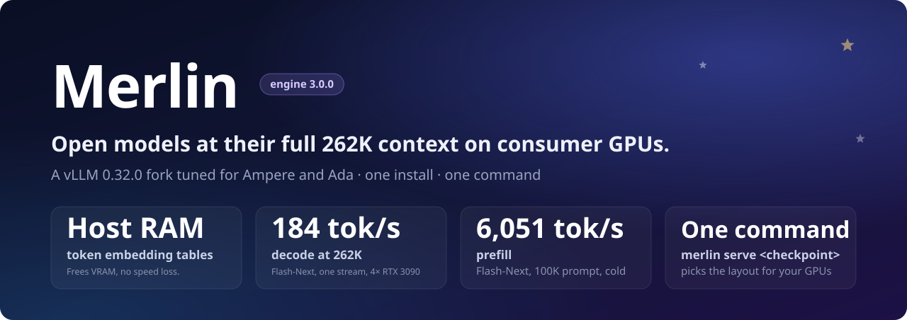
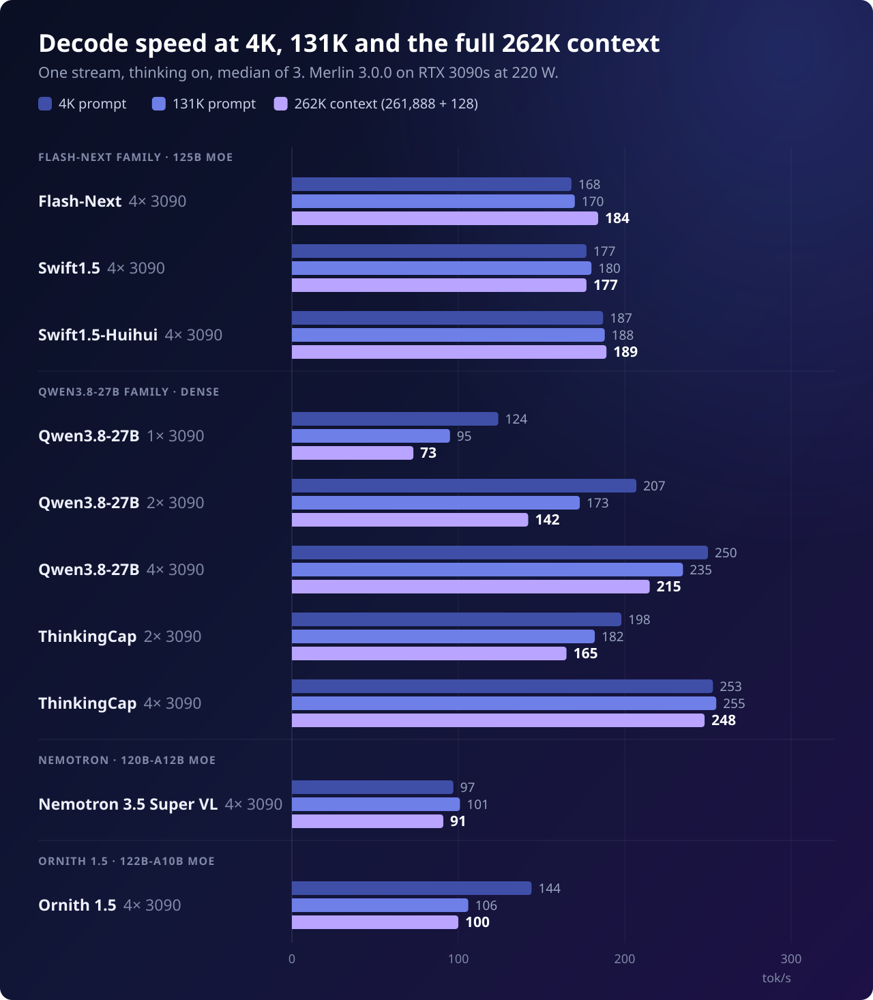

<!-- Modified by the Merlin project; see NOTICE. -->
<div align="center">

, picks the layout for your GPUs." width="100%">

[](https://github.com/vllm-project/vllm/tree/v0.32.0)
[](#hardware)
[](#models)
[](LICENSE)
[](https://ko-fi.com/halt95)

<b><a href="#models">Models</a> · <a href="#what-merlin-adds-to-vllm">What Merlin adds</a> · <a href="#performance">Performance</a> · <a href="#quick-start">Quick start</a> · <a href="#requirements">Requirements</a> · <a href="#hardware">Hardware</a> · <a href="#bench-cards">Bench cards</a> · <a href="docs/how-to-serve.md">How to serve</a> · <a href="docs/CHANGELOG.md">Changelog</a></b>

</div>

<br>

Merlin is a fork of [vLLM](https://github.com/vllm-project/vllm) 0.32.0 tuned for NVIDIA Ampere and Ada cards
(sm_80, sm_86, sm_89), with ready-made recipes for seven W4A16 checkpoints. It is built,tuned and measured on four
RTX 3090s and serves an OpenAI-compatible API with vision, reasoning and tool calling. One install, one command with pre-tuned profiles for your detected GPU.

## Models

| Checkpoint | Base | GPUs | KV pool, tokens | Decode, 1 user, tok/s<br>4K / 131K / 262K | 8 agents, tok/s | GSM8K-200 |
|---|---|---|---|---|---|---|
| [Flash-Next](https://huggingface.co/halt95/Qwen3.8-Flash-Next-W4A16-Merlin) | Qwen3.8-Flash-Next, 125B MoE | 4×&nbsp;3090 | 924,993 | 168 / 170 / 184 | 638 | 199 |
| [Swift1.5](https://huggingface.co/halt95/Swift1.5-Qwen3.8-Flash-Next-W4A16-Merlin) | Flash-Next fine-tune | 4×&nbsp;3090 | 924,993 | 177 / 180 / 177 | 643 | 197 |
| [Swift1.5-Huihui](https://huggingface.co/halt95/Swift1.5-Huihui-Qwen3.8-Flash-Next-W4A16-Merlin) | Swift1.5, abliterated | 4×&nbsp;3090 | 924,993 | 187 / 188 / 189 | 660 | 198 |
| [Qwen3.8-27B](https://huggingface.co/halt95/Qwen3.8-27B-W4A16-Merlin) | Qwen3.8-27B, dense | 1×&nbsp;3090 | 271,506 | 124 / 95 / 73 | n/a (two at most) | 195 |
| | | 2×&nbsp;3090 | 826,689 | 207 / 173 / 142 | 517 | 194 |
| | | 4×&nbsp;3090 | 2,012,105 | 250 / 235 / 215 | 752 | 197 |
| [ThinkingCap](https://huggingface.co/halt95/ThinkingCap-Qwen3.8-27B-W4A16-Merlin) | Qwen3.8-27B fine-tune | 2×&nbsp;3090 | 826,689 | 198 / 182 / 165 | 502 | 193 |
| | | 4×&nbsp;3090 | 2,012,105 | 253 / 255 / 248 | 733 | 195 |
| [Nemotron 3.5 Super VL](https://huggingface.co/halt95/Nemotron-3.5-Super-VL-120B-A12B-W4A16-Merlin) | Nemotron 3.5 Super VL, 120B-A12B MoE | 4×&nbsp;3090 | 1,856,367 (1M context; 1,392,275 at 262K) | 97 / 101 / 91 | 429 | 195 |
| [Ornith 1.5](https://huggingface.co/halt95/Ornith-1.5-122B-A10B-W4A16-Merlin) | Qwen3.5-122B-A10B fine-tune (ornith-ai), 122B MoE | 4×&nbsp;3090 | 894,618 | 144 / 106 / 100 | 468 | 190 |

Every checkpoint runs on the same engine at its native context (262,144 tokens; Nemotron 3.5 Super VL 1,048,576), with an FP8 KV cache, MTP
speculative decoding and vision: an 8-megapixel image cap (Nemotron: its native ~3.4 MP; the one-card 27B layout: 4 MP). The whole KV cache stays in VRAM.

<sub>Measured on 4× RTX 3090 without NVLink, P2P on, at 220 W, Merlin 3.0.0, 2026-10-20 bench cards (27B one- and two-card agents/GSM8K, ThinkingCap two-card and Nemotron agents/GSM8K are from a 2026-10-17 pre-release build). Decode: one stream, thinking on, at a 4K prompt / a 131K prompt / the full
262,144-token context (261,888 prompt + 128 out); median of 3 runs, same method as the v2.x cards (Nemotron's 131K prompt is 136,625 tokens with its own tokenizer). 8 agents: eight 16K conversations, then eight
simultaneous 512-token follow-ups, total tok/s (one card runs two sequences at most). GSM8K-200: correct answers out of 200. Ornith 1.5: measured 2026-10-21 on the
reference host with uniform MoE verify on, its 8 agents on the released install; its
[bench card](models/ornith1.5/benchmarks/2026-10-21/BENCH-CARD.md) is dated 2026-10-21. Swift1.5-Huihui's 8 agents: re-run on the released install, 2026-10-21 (the bench-card run did not overlap).</sub>

## What Merlin adds to vLLM

**More context in the same VRAM**

- **Token embedding tables in host RAM.** The token embedding tables of the main model and its MTP drafter are read
  from pinned host memory, on by default for the Flash-Next and Qwen3.8-27B families (about 1.2 GiB per card freed on
  27B at TP=2), with no speed loss.
- **N-gram embedding table in host RAM.** Flash-Next's n-gram embedding table (about 47.7 GiB) lives in system
  memory, one copy shared by every GPU, so the VRAM goes to KV cache: a 924,993-token pool on four RTX 3090s, three
  full 262K sessions resident at once.
- **FP8 KV cache on Ampere.** An sm_86 FP8 QSA attention reader for Flash-Next, and an sm_86 FP8 small-query verify
  tile for 27B, so every checkpoint keeps an FP8 KV cache on cards with no native FP8.

**Faster decode and prefill**

- **RecoverSSM on every checkpoint.** RecoverSSM recovers the GDN and Mamba-2 state for MTP speculative decoding,
  on by default for Flash-Next, Swift1.5, Swift1.5-Huihui, Qwen3.8-27B, ThinkingCap, Nemotron 3.5 Super VL and
  Ornith 1.5. The Flash-Next family drafts over the full vocabulary with a BF16 draft head.
- **Faster prefill than our last release.** Flash-Next cold prefill 5,417 → 6,051 tok/s on a 100K prompt (+12 %)
  against v2.5.3; Qwen3.8-27B on four cards 2,483 → 3,009 tok/s at 10K (+21 %) against v1.3.0.
- **All-reduce tuned for PCIe P2P.** Flash-Next on P2P hosts uses a PCIe IPC all-reduce for decode-sized messages
  and NCCL's Simple protocol for prefill.
- **Marlin W8A16** for Flash-Next's INT8 GDN projections.

**Built for agents**

- **Follow-ups resume from cache.** Prefix-cache retention keeps each conversation's prefix on a 64-token grid
  instead of the 4,096-token block, so the next turn starts from cache instead of re-reading the whole conversation
  (Flash-Next v2.5.1: median follow-up time to first token 0.96 s, was 1.56 s).
- **Cache-thrash protection, on by default.** Cost-aware admission and session-coherent yields keep follow-ups
  cached when more sessions are open than the pool holds: under 8 × 131K and 12 × 80K oversubscription, follow-up
  turns reused 74.7 % and 82.1 % of their prompt from cache.
- **A chat template that keeps the cache.** Every Qwen recipe serves a fixed Qwen3.8 template that accepts system
  messages after the first turn, so coding agents' per-turn notes no longer break the prefix cache.
- **Vision, reasoning and tool calling on every checkpoint,** with images up to 8 MP (Nemotron its native ~3.4 MP,
  one-card 27B 4 MP) and a per-image pixel cap (`MAX_PIXELS`).

**Steady in long runs**

- **Repeatable greedy output and fault detection on any rank**, with faster shutdown.
- **Idle cards drop to P8** with the runtime bounds guards on: 110 W idle on four RTX 3090s, against 446 W when the
  guard reader kept them awake.

**One install, one command**

- **`./setup.sh`** checks the host, recommends a checkpoint and layout for your GPUs, shows every download with its
  size, installs the prebuilt engine (about 1.5 minutes, no compiling, nothing system-wide) and starts the server.
- **`merlin serve <checkpoint>`** recognises the checkpoint, picks the largest tested layout for the GPUs it finds,
  and starts the server; `merlin doctor` checks the host first. Every layout is a profile of `tools/merlin/launch.py`;
  every knob (`PORT`, `HOST`, `KV_BYTES`, `MAX_PIXELS`, ...) is an environment variable.
- **Profiles beyond the reference host:** RTX 3090 without P2P, eight RTX 3090s, RTX 4090 (24 and 48 GB),
  RTX A6000 / A40, A100, A30 and CMP 170HX.
- **One prebuilt wheel** for sm_80, sm_86 and sm_89, installed from a hash-locked requirements file.
- **New variants just work.** A Flash-Next-family checkpoint that ships its own FP8 KV scales is served with them,
  with no repository update.

## Performance



**Prefill and time to first token at the full 262K context**

| Checkpoint | GPUs | Prefill, 262K prompt | Time to first token |
|---|---|---|---|
| Flash-Next | 4× 3090 | 5,838 tok/s | 44.9 s |
| Swift1.5 | 4× 3090 | 5,834 tok/s | 44.9 s |
| Swift1.5-Huihui | 4× 3090 | 5,880 tok/s | 44.5 s |
| Qwen3.8-27B | 1× 3090 | 456 tok/s | 574.1 s |
| | 2× 3090 | 858 tok/s | 305.3 s |
| | 4× 3090 | 1,596 tok/s | 164.1 s |
| ThinkingCap | 2× 3090 | 860 tok/s | 304.6 s |
| | 4× 3090 | 1,594 tok/s | 164.3 s |
| Nemotron 3.5 Super VL | 4× 3090 | 2,951 tok/s | 88.8 s |
| Ornith 1.5 | 4× 3090 | 1,704 tok/s | 153.7 s |

<sub>One stream, the 261,888-token needle prompt, cold (nothing in the prefix cache), thinking on; prefill = prompt tokens /
time to first token. The needle is found in 3 of 3 thinking-off sends on every checkpoint.</sub>

Full per-checkpoint bench cards (decode ladder thinking on and off, exact 262K, cold prefill, comparison with the previous
release), 2026-10-20:

<a id="bench-cards"></a>[Flash-Next](models/flash-next/benchmarks/2026-10-20/BENCH-CARD.md) · [Swift1.5](models/swift1.5/benchmarks/2026-10-20/BENCH-CARD.md) · [Swift1.5-Huihui](models/swift1.5-huihui/benchmarks/2026-10-20/BENCH-CARD.md) · [Qwen3.8-27B](models/qwen38-27b/benchmarks/2026-10-20/BENCH-CARD.md) · [ThinkingCap](models/thinkingcap/benchmarks/2026-10-20/BENCH-CARD.md) · [Nemotron 3.5 Super VL](models/nemotron-super-vl/benchmarks/2026-10-20/BENCH-CARD.md) · [Ornith 1.5](models/ornith1.5/benchmarks/2026-10-21/BENCH-CARD.md). Earlier releases' cards are in each recipe's `benchmarks/` folder.

<details>
<summary><b>Prefill against the previous release</b>: Flash-Next family +12–13 %, Qwen3.8-27B up to +21 % on 4× 3090</summary>

<br>

**Flash-Next, Swift1.5 and Swift1.5-Huihui against v2.5.3**

| Checkpoint (4× 3090) | Prefill, 10K prompt | Prefill, 100K prompt | TTFT, 10K prompt | TTFT, 100K prompt |
|---|---|---|---|---|
| Flash-Next | 5,020 → 5,660 tok/s (+13%) | 5,417 → 6,051 tok/s (+12%) | 2.03 → 1.80 s (−11%) | 18.81 → 16.84 s (−10%) |
| Swift1.5 | 5,013 → 5,676 tok/s (+13%) | 5,413 → 6,055 tok/s (+12%) | 1.80 s on 3.0.0 | 16.83 s on 3.0.0 |
| Swift1.5-Huihui | 5,028 → 5,706 tok/s (+13%) | 5,446 → 6,097 tok/s (+12%) | 1.79 s on 3.0.0 | 16.71 s on 3.0.0 |

<sub>v2.5.3 → Merlin 3.0.0, one stream, cold prefill of a ~10K and a ~100K prompt. v2.5.3 added Swift1.5-Huihui and kept the
v2.5.2 engine unchanged, so its figures are the v2.5.2 runs. Flash-Next: same method and prompts as the v2.5.2 bench card.
Swift1.5 and Swift1.5-Huihui: figures from the Swift1.5-Huihui card's speed run on that engine, whose decode used a
different send protocol, so only prefill is compared.</sub>

**Qwen3.8-27B against v1.3.0**

| GPUs | Prefill, 10K prompt | Prefill, 100K prompt | TTFT, 128K prompt | TTFT, 255K prompt |
|---|---|---|---|---|
| 2× 3090 | 1,739 → 1,823 tok/s (+5%) | 1,267 → 1,297 tok/s (+2%) | 112.6 → 109.5 s (−3%) | 303.9 → 301.4 s (−1%) |
| 4× 3090 | 2,483 → 3,009 tok/s (+21%) | 1,989 → 2,295 tok/s (+15%) | 69.8 → 61.2 s (−12%) | 179.3 → 161.6 s (−10%) |

<sub>v1.3.0 → Merlin 3.0.0, same method as the v1.3.0 bench card: one stream, every request a cold prefill, median of 3
(the 255K prompt is about 259,600 tokens). Decode speed per step is unchanged.</sub>

</details>

## Quick start

```bash
git clone https://github.com/halt95/merlin-engine.git && cd merlin-engine && ./setup.sh
```

After a small uv and Python bootstrap, `./setup.sh` checks the GPUs, driver, RAM and disk, recommends a checkpoint and
layout for your hardware, shows the engine, package and checkpoint downloads with their sizes before fetching them, installs the prebuilt engine, downloads and verifies the checkpoint,
and starts an OpenAI-compatible server on `127.0.0.1:8000` (27B and ThinkingCap: `8100`). Enter takes the recommended answer at each question.
Run it again to start the server with the saved answers; `git pull && ./setup.sh` updates the engine without
downloading the model again. `--model flash-next|swift1.5|swift1.5-huihui|27b|27b-thinkingcap|nemotron-super-vl|ornith1.5`
picks the checkpoint, `--yes` takes every recommended answer and `--dry-run` shows the plan. Nothing is installed
system-wide.

**[How to serve](docs/how-to-serve.md)** walks through it end to end: the questions, talking to the server, serving on
your network, choosing GPUs, switching models and fixing problems.

<details>
<summary><b>Manual install</b></summary>

```bash
git clone https://github.com/halt95/merlin-engine.git && cd merlin-engine
curl -LO https://github.com/halt95/merlin-engine/releases/download/merlin-v3.0.0/vllm-0.32.0+merlin.7002f56537-cp313-cp313-linux_x86_64.whl
MERLIN_WHEEL="$PWD/vllm-0.32.0+merlin.7002f56537-cp313-cp313-linux_x86_64.whl"   bash release/install-env.sh ./venv        # one install for every checkpoint

venv/bin/hf download halt95/Qwen3.8-Flash-Next-W4A16-Merlin --local-dir ~/models/flash-next
(cd ~/models/flash-next && sha256sum -c "$OLDPWD/models/flash-next/checkpoint.sha256")
venv/bin/python merlin_cli.py serve ~/models/flash-next
```

`MERLIN_WHEEL` installs the prebuilt engine (sm_80, sm_86, sm_89), checked against `release/merlin-wheel.sha256`;
without it the installer compiles the engine instead, about 1.5 hours on 8 cores. `merlin serve` recognises the
checkpoint, picks the largest tested layout for the GPUs it finds and starts the server on `127.0.0.1:8000` (`8100` for 27B and ThinkingCap). Add
`--dry-run` to print the resolved command without starting anything. The first start compiles kernels; the server is
ready at `Application startup complete`.

</details>

### Choose your GPUs

The same install serves every layout. `merlin serve` picks one for you, and you can pick it yourself:

```bash
GPUS=5,6 venv/bin/merlin serve ~/models/qwen38-27b                  # 27B on GPUs 5 and 6 (TP=2)
GPUS=9,10,11,12 PORT=8101 venv/bin/merlin serve ~/models/qwen38-27b # 27B on GPUs 9-12 (TP=4), its own port
venv/bin/merlin serve ~/models/qwen38-27b --tp 2 --instances 4      # four TP=2 servers on 8 GPUs, ports 8100-8103
venv/bin/merlin serve ~/models/qwen38-27b --tp 1 --instances 4      # four one-GPU servers
venv/bin/merlin serve ~/models/flash-next --dry-run                 # print the plan, start nothing
```

- **`GPUS=`** (or `CUDA_VISIBLE_DEVICES=`) uses exactly those cards, and the layout follows the count: two cards
  give TP=2, four give TP=4.
- **`--tp N`** picks the layout by tensor-parallel size on a larger host. **`--profile <id>`** forces one profile;
  `venv/bin/merlin list` shows them all.
- **`--instances N`** starts N servers on separate card sets, each with its own ports and compile cache. Sets follow
  the board: cards that can talk peer-to-peer first, then cards on the same CPU socket or PCIe switch.
- On cards without peer-to-peer (RTX 4090, CMP 170HX and most hosts outside the reference host), several one-GPU 27B
  servers give more total throughput for many users than one large server. On 4 x CMP 170HX, eight agents at 16K
  measured 873 tok/s on `--tp 1 --instances 4`, 523 on two TP=2 servers and 371 on one TP=4 server; 4 x RTX 4090
  showed the same order for prefill. One TP=4 server stays fastest for a single request and holds the largest pool.
- On cards without peer-to-peer, every checkpoint runs its no-P2P profile: the same layout with P2P off, marked
  untested where we have not run it on those cards. `venv/bin/merlin doctor` checks the host before anything starts.

## Requirements

| | |
|---|---|
| OS | Linux x86-64 (glibc 2.38 or newer), bare metal or LXC. A VM with GPU passthrough works but gets a preflight warning. |
| NVIDIA driver | CUDA 13 (R580 or later). The CUDA 13.0 toolkit comes with the install; the reference host runs driver 610.43.02. |
| Python | 3.13 with development headers, and [uv](https://docs.astral.sh/uv/). |
| Build tools | Git and GCC/G++ 13 or newer: FlashInfer compiles kernels on first start. Building the engine from source instead of using the prebuilt wheel also needs Cargo/Rust and takes about 1.5 hours on 8 cores. |
| GPUs | NVIDIA sm_80, sm_86 or sm_89, headless, with no other CUDA process on them. Which cards and layouts: [Hardware](#hardware). |
| Shared memory | `/dev/shm` of at least 1 GB (the container recipes use 8 GB). |

| Checkpoint | GPUs | Host RAM | Disk |
|---|---|---|---|
| Flash-Next, Swift1.5, Swift1.5-Huihui | 4× 24 GB | 96 GiB reference allocation: the n-gram embedding table alone takes about 47.7 GiB; the minimum has not been re-measured on 3.0.0 | about 115 GiB for the checkpoint, plus the environment and caches |
| Qwen3.8-27B, ThinkingCap | 1×, 2× or 4× 24 GB (2 and 4 cards with GPU peer-to-peer on RTX 3090s; one card takes images up to 4 MP) | about 2.4 GiB pinned for the host-resident embeddings, on top of normal use | Pending |
| Nemotron 3.5 Super VL | 4× 24 GB | Pending | Pending |
| Ornith 1.5 | 4× 24 GB, with or without P2P | Pending | about 66.4 GiB for the checkpoint, plus the environment and caches |

`merlin doctor` checks the GPUs, driver, host RAM and shared memory against these; the installer checks the compiler.

## Hardware

| Hardware | VRAM per card | Arch | Profiles | Testing | Performance |
|---|---|---|---|---|---|
| 4× RTX 3090, PCIe p2p | 24 GB | sm_86 | Included | 🟢 Tested | 🟢 Optimised |
| 2× RTX 3090 | 24 GB | sm_86 | Included | 🟢 Tested | 🟢 Optimised |
| 4× RTX 3090 w/o p2p | 24 GB | sm_86 | Included | ⚫ Untested | 🟠 Optimising |
| 8× RTX 3090 | 24 GB | sm_86 | Included | ⚫ Untested | 🟠 Optimising |
| 4× RTX 4090 | 24 GB | sm_89 | Included | ⚫ Untested | 🔴 Unoptimised |
| 4× RTX 4090 | 48 GB (modded) | sm_89 | Included | ⚫ Untested | 🔴 Unoptimised |
| 4× CMP 170HX | 64 GB (unlocked) | sm_80 | Included | 🟢 Tested | 🟠 Optimising |
| 2× CMP 170HX | 64 GB (unlocked) | sm_80 | Included | ⚫ Untested | 🟠 Optimising |
| A100 | 40 / 80 GB | sm_80 | Included | ⚫ Untested | 🔴 Unoptimised |
| A30 | 24 GB | sm_80 | Included | ⚫ Untested | 🔴 Unoptimised |

🟢 **Tested**: measured on our hardware. ⚫ **Untested**: a profile ships; not run by us yet, expected to work.
🟢 **Optimised**: measured and tuned on this hardware. 🟠 **Optimising**: works, tuning in progress. 🔴 **Unoptimised**: runs on the stock
profile, not tuned yet.

### Which checkpoint runs where

Find your GPUs and card count. Each cell says how the checkpoint runs there and how many full 262K-token
conversations it holds at once; `merlin serve` and `./setup.sh` pick the setup from the GPUs they find. Nemotron,
native 1M, has its own table below.

| Setup | Flash-Next, Swift1.5, Huihui | Qwen3.8-27B, ThinkingCap | Ornith 1.5 |
|---|---|---|---|
| 1× RTX 3090 | needs 4 cards | 🟢 1 session | needs 4 cards |
| 2× RTX 3090 | needs 4 cards | 🟢 3 sessions | needs 4 cards |
| 4× RTX 3090 | 🟢 3 sessions | 🟢 7 sessions | 🟢 3 sessions |
| 8× RTX 3090 | ⚫ 17 sessions | 🟢 2 servers × 7 sessions (4 cards each) | 🟢 2 servers × 3 sessions (4 cards each) |
| 2× RTX 3090, no P2P | needs 4 cards | ⚫ 3 sessions | needs 4 cards |
| 4× RTX 3090, no P2P | ⚫ 3 sessions | ⚫ 7 sessions | 🟢 3 sessions |
| 8× RTX 3090, no P2P | ⚫ 17 sessions | ⚫ 2 servers × 7 sessions (4 cards each) | 🟢 2 servers × 3 sessions (4 cards each) |

<details>
<summary><b>Other Ampere and Ada GPUs</b>: RTX A6000 / A40, RTX 4090, 32 and 48 GB Ada cards, A30, A100, CMP 170HX</summary>

| Setup | Flash-Next, Swift1.5, Huihui | Qwen3.8-27B, ThinkingCap | Ornith 1.5 |
|---|---|---|---|
| 1× RTX A6000 / A40, 48 GB | needs 2 cards | ⚫ 3 sessions | no profile yet |
| 2× RTX A6000 / A40, 48 GB | ⚫ 5 sessions | ⚫ 8 sessions | no profile yet |
| 4× RTX A6000 / A40, 48 GB | ⚫ 25 sessions | ⚫ 18 sessions | no profile yet |
| 1× RTX 4090, 24 GB | needs 4 cards | ⚫ 1 session | no profile yet |
| 2× RTX 4090, 24 GB | needs 4 cards | ⚫ 3 sessions | no profile yet |
| 4× RTX 4090, 24 GB | ⚫ 3 sessions | ⚫ 7 sessions | no profile yet |
| 1× RTX 4080 Super, 32 GB (modified) | needs 4 cards | ⚫ 1 session | no profile yet |
| 2× RTX 4080 Super, 32 GB (modified) | needs 4 cards | ⚫ 3 sessions | no profile yet |
| 4× RTX 4080 Super, 32 GB (modified) | ⚫ 10 sessions | ⚫ 7 sessions | no profile yet |
| 1× RTX 6000 Ada / L40S / RTX 4090 48 GB | needs 2 cards | ⚫ 1 session | no profile yet |
| 2× RTX 6000 Ada / L40S / RTX 4090 48 GB | ⚫ 5 sessions | ⚫ 3 sessions | no profile yet |
| 4× RTX 6000 Ada / L40S / RTX 4090 48 GB | ⚫ 25 sessions | ⚫ 7 sessions | no profile yet |
| 1× A30, 24 GB | needs 4 cards | ⚫ 1 session | no profile yet |
| 2× A30, 24 GB | needs 4 cards | ⚫ 3 sessions | no profile yet |
| 4× A30, 24 GB | ⚫ 1 session | ⚫ 7 sessions | no profile yet |
| 1× CMP 170HX, 32 GB | needs 3 cards | ⚫ 1 session | no profile yet |
| 2× CMP 170HX, 32 GB | needs 3 cards | ⚫ 4 sessions | no profile yet |
| 4× CMP 170HX, 32 GB | ⚫ 4 sessions | ⚫ 11 sessions | no profile yet |
| 1× A100 40 GB / CMP 170HX 40 GB | needs 4 cards | ⚫ 2 sessions | no profile yet |
| 2× A100 40 GB / CMP 170HX 40 GB | needs 4 cards | ⚫ 6 sessions | no profile yet |
| 4× A100 40 GB / CMP 170HX 40 GB | ⚫ 7 sessions | ⚫ 14 sessions | no profile yet |
| 1× CMP 170HX, 64 GB | needs 2 cards | ⚫ 5 sessions | no profile yet |
| 2× CMP 170HX, 64 GB | ⚫ 6 sessions | ⚫ 11 sessions | no profile yet |
| 4× CMP 170HX, 64 GB | 🟢 17 sessions (8 at once) | ⚫ 25 sessions | no profile yet |
| 1× A100, 80 GB | ⚫ 1 session | ⚫ 7 sessions | no profile yet |
| 2× A100, 80 GB | ⚫ 11 sessions | ⚫ 15 sessions | no profile yet |
| 4× A100, 80 GB | ⚫ 28 sessions | ⚫ 32 sessions | no profile yet |

</details>

**Nemotron 3.5 Super VL** serves its native 1,048,576-token context, with the 262K count beside it. It needs four cards (or two servers of four). The 1M counts are
the KV pool divided by 1,048,576; on 4× RTX 3090 a 1,048,052-token needle came back exact and, re-sent, was served from the resident cache (1,047,936 tokens cached, 3 s to first token).

| Setup | Full 1M conversations | Full 262K conversations |
|---|---|---|
| 4× RTX 3090 | 🟢 1 session | 🟢 5 sessions |
| 8× RTX 3090 | 🟢 2 servers × 1 session (4 cards each) | 🟢 2 servers × 5 sessions (4 cards each) |
| 4× RTX 3090, no P2P | ⚫ 1 session | ⚫ 5 sessions |
| 8× RTX 3090, no P2P | ⚫ 2 servers × 1 session (4 cards each) | ⚫ 2 servers × 5 sessions (4 cards each) |
| 4× RTX A6000 / A40, 48 GB | ⚫ 13 sessions | ⚫ 54 sessions (32 at once) |
| 4× RTX 4090, 24 GB | ⚫ 1 session | ⚫ 5 sessions |
| 4× RTX 4080 Super, 32 GB (modified) | ⚫ 1 session | ⚫ 5 sessions |
| 4× RTX 6000 Ada / L40S / RTX 4090 48 GB | ⚫ 1 session | ⚫ 5 sessions |
| 4× A30, 24 GB | ⚫ 1 session | ⚫ 5 sessions |
| 4× CMP 170HX, 32 GB | ⚫ 5 sessions | ⚫ 21 sessions |
| 4× A100 40 GB / CMP 170HX 40 GB | ⚫ 9 sessions | ⚫ 37 sessions (32 at once) |
| 4× CMP 170HX, 64 GB | ⚫ 21 sessions | ⚫ 86 sessions (32 at once) |
| 4× A100, 80 GB | ⚫ 29 sessions | ⚫ 119 sessions (32 at once) |

<sub>🟢 tested on our hardware · ⚫ expected to run: the engine's own estimate, not yet run by us.
"2 servers × 7 sessions" means two separate servers on the cards (`merlin serve --instances 2`). On 8× RTX 3090 with P2P, `merlin serve` picks the tested four-card Flash-Next layout (3 sessions); the 17-session eight-card layout is `--profile fn-octo-3090-tp2pp4` (untested). Without P2P it is the default.
"N sessions (M at once)" means the KV cache holds N full 262K conversations but the server
admits M requests at a time; the rest queue. Without P2P, the 27B
and Nemotron run the same layouts with P2P off (⚫ until we run them on RTX 3090s). The 3090 Ti and
RTX A5000 run the RTX 3090 profiles, untested on those cards (⚫). In the Flash-Next column, Swift1.5 and Swift1.5-Huihui have no 8-card or 4× CMP 170HX
64 GB profile yet. KV cache: FP8 everywhere, except Flash-Next and its fine-tunes on sm_80 cards (A30, A100, CMP 170HX),
which use BF16, so fewer sessions fit; FP8 for Flash-Next on these cards comes in a 3.0.x update (about twice the
sessions). On 4× CMP 170HX 64 GB the 27B (one, two and four cards) and Nemotron ran with
FP8 KV, 262K needles exact. Source: the engine's profile registry (`tools/merlin/profiles/`).</sub>

## Coming from qwen38-flash-next-3090s

This repository is its successor: the engine now lives at the root and each model has a recipe under
`models/`. Make a fresh install with `release/install-env.sh`, then point an existing clone at the new name:

```bash
git remote set-url origin https://github.com/halt95/merlin-engine.git
```

## Support

Merlin is built and measured on one home machine. If it saves you time, you can support the work on
[Ko-fi](https://ko-fi.com/halt95).

## Credits

**Models**

- [Qwen](https://huggingface.co/Qwen): Qwen3.8-Flash-Next, Qwen3.8-27B, and [Qwen3.5-122B-A10B](https://huggingface.co/Qwen/Qwen3.5-122B-A10B),
  the base of Ornith 1.5.
- [UkisAI](https://huggingface.co/ukisai/Swift1.5-Qwen3.8-Flash-Next): Swift 1.5.
- [huihui-ai](https://huggingface.co/huihui-ai/Huihui-Qwen3.8-Flash-Next-abliterated): the abliteration in
  Swift1.5-Huihui (method from [remove-refusals-with-transformers](https://github.com/Sumandora/remove-refusals-with-transformers)).
- BottleCap AI: ThinkingCap.
- NVIDIA: Nemotron 3.5 Super VL.
- [ornith-ai](https://huggingface.co/ornith-ai/Ornith-1.5-122B): Ornith 1.5.

**Quantisation**

- Intel (AutoRound experts), RadixArk (FP8 PLE table) and DominikBucko (MTP packing recipe), for the Flash-Next
  family.
- [philbert](https://huggingface.co/philbert440): the AWQ INT4 body of Qwen3.8-27B and the AWQ recipe behind ThinkingCap.

**Engine and serving**

- The [vLLM](https://github.com/vllm-project/vllm) project, which Merlin is built on, with FlashInfer,
  compressed-tensors and the vLLM community's PLE-offload work.
- [froggeric](https://huggingface.co/froggeric/Qwen-Fixed-Chat-Templates): the fixed Qwen3.8 chat template every Qwen
  recipe serves.
- aikitoria: peer-to-peer on consumer Ampere.
- [brandon-nuttall](https://github.com/brandon-nuttall): `use_local_argmax_reduction` with the Flash-Next MTP drafter.
- [CoolShades](https://github.com/CoolShades) idle-power report and first fix behind the v2.5.2 engine fix.
- [Neiko2002](https://huggingface.co/Neiko2002) and [Yarikdevcom](https://github.com/yarikdevcom).

Upstream fixes are credited in the engine repository; each checkpoint's licence is on its card.

## Licence

The engine is Apache-2.0, like vLLM; see [LICENSE](LICENSE) and [NOTICE](NOTICE). Each checkpoint has its own
weight licence on its Hugging Face card.
