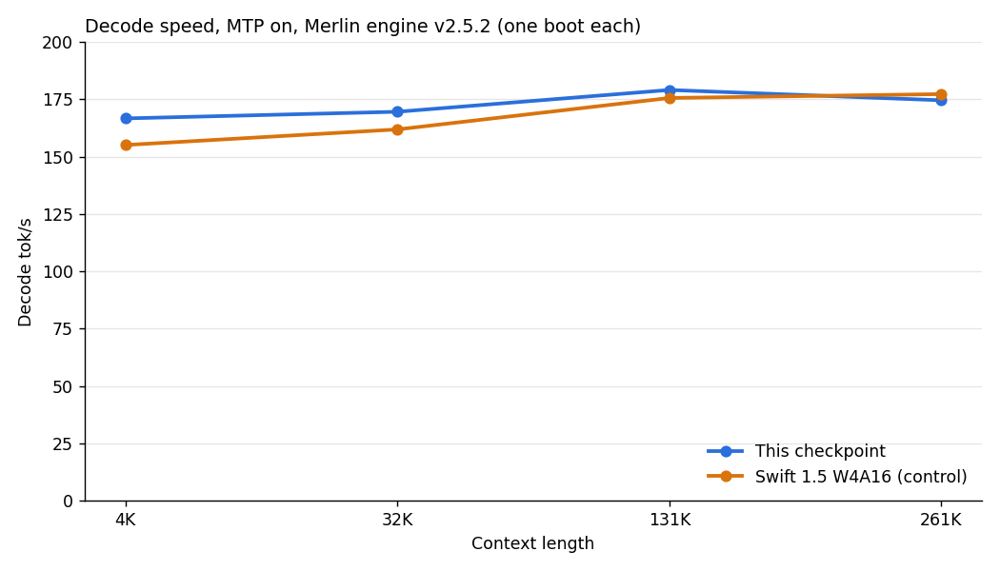

# Swift1.5-Huihui bench card — 2026-10-12 (abliterated Swift 1.5 checkpoint; gate on v2.5.1, speed on v2.5.2)

Checkpoint: [halt95/Swift1.5-Huihui-Qwen3.8-Flash-Next-W4A16-Merlin](https://huggingface.co/halt95/Swift1.5-Huihui-Qwen3.8-Flash-Next-W4A16-Merlin),
served by `scripts/serve-huihui.sh`. The engine's own card for v2.5.2 is [`BENCH-CARD.md`](BENCH-CARD.md).

> **Provenance.** These are the maintainer's measurements on the reference host: 4× RTX 3090 at 220 W, PCIe Gen4 x16 with
> peer-to-peer, no NVLink, 152 GiB host RAM. Engine: the reference host's v2.5.1 tree, which is vLLM 0.30.0 plus the
> v2.5.1 commits (`96a0d13b6e`, the published source). It runs with transformers 5.18.0 and the host's serve command:
> the published `serve-v2.5.sh` flags with `xhigh` as the default reasoning effort.
> The quality gate (the table below) ran on that tree, not through `scripts/serve-huihui.sh`. The speed runs (the Speed
> section) went through this repository's v2.5.2 launcher `scripts/serve-v2.5.sh` on a fresh bundle install.
> The gate ran with Swift 1.5's earlier `tokenizer.json` (sha256 `06b95093…`). The checkpoint ships Qwen's upstream file
> (sha256 `0997f410…`), the one the Swift 1.5 W4A16 checkpoint has shipped since 2026-10-06: vocabulary and merges are
> the same, only text with combining marks splits differently; the swap was smoke-tested, not re-gated (see Install and
> serve). The drivers, raw outputs and boot logs are not published.
>
> The two checkpoints were served one after the other in one run (2026-10-11 22:07 to 2026-10-12 00:27 UTC). The
> command was the same apart from the model path and the KV-scale sidecar.

| | this checkpoint | Swift 1.5 W4A16 (control) |
|---|---|---|
| KV pool (tokens) | 924,993 | 924,993 |
| weights per card, first / second pipeline stage | 17.44 / 16.96 GiB | 17.44 / 16.96 GiB |
| memory at ready, per card | 22,766–22,820 MiB | 22,672–22,762 MiB |
| agent turns at `xhigh`, completion tokens (6 runs × 18 turns) | **71,588 (0.86×, 95 % CI 0.64–1.15)** | 83,582 |
| agent turns that ended empty | 0 / 108 | 0 / 108 |
| GSM8K, full test set (1,319) | **96.29 %** | 95.98 % |
| GSM8K completion tokens | 190,206 (0.99×) | 191,466 |
| structured output (16 JSON-schema requests, thinking on) | 16 / 16 | 16 / 16 |
| needle at 258,048 prompt tokens, found exactly | PASS | not run |
| tool call, reasoning and image smoke tests | PASS | not run |
| MTP mean acceptance length (engine counter, whole run) | 2.63 | 2.70 |
| XSTest safe prompts: refused, marker-scored | 1 / 246 (0.4 %) | 9 / 249 (3.6 %) |
| StrongREJECT harmful prompts (313): refused | **29 / 278 finished (10.4 %), judged; 35 cut off** | 302 / 312 (96.8 %; 1 cut off), marker-scored |
| engine errors | 0 | 0 |

- **Agent turns.** Six agents with 30K–130K-token contexts, three turns each, served sampling at `xhigh` and up to
  8,192 tokens per turn. Tool calls get fixed repository snippets. The battery ran six times. The ratio compares total
  completion tokens; the CI is a bootstrap stratified by agent (10,000 resamples). It includes parity.
- **GSM8K.** Served sampling at `xhigh`. Difference +0.30 points (95 % CI −0.66 to +1.29; exact McNemar p = 0.64).
  16 and 15 answers hit the token limit.
- **Refusals.** Each prompt was sent once with served sampling, no system prompt and up to 8,192 tokens. 35 of this
  checkpoint's 313 StrongREJECT answers hit that limit and were not judged. The other 278 were judged blind by GLM 5.3
  Flash (one run, not checked against human labels): 29 refused (10.4 %) and 16 more refused in part. A second judge
  model, which labelled half of them, puts the merged rate at 9.4–18.7 % of the 278 (the top end counts the two
  judges' disagreements and partial refusals as refusals). An unreleased earlier build of this checkpoint refused 124 of its 276 judged answers
  (44.9 %) under the same judge and prompts; a keyword count had shown 0 % for it, because keywords miss soft refusals.
  The Swift 1.5 and XSTest figures are keyword counts (the scorer's refusal markers, reasoning stripped, answers cut off
  at the limit excluded). Treat the checkpoint as a model that does not refuse.
- **Pilot.** Before the refusal battery, a 40-prompt pilot on Swift 1.5 had 2 answers (5 %) cut at the 8,192-token
  limit, above the run's 3 % threshold. The run continued, with this noted.
- **Earlier build.** An unreleased first build of this checkpoint also replaced the routed experts with huihui-ai's,
  re-quantised to INT4. It wrote 1.53× Swift 1.5's agent tokens. This build keeps Swift 1.5's experts.

## Speed on v2.5.2

Same host, 2026-10-12. Fresh install of engine v2.5.2 from its release bundle, served through the package launcher
`serve-v2.5.sh` with defaults (guard on in warn mode with idle parking, MTP on). One boot per checkpoint, back to back,
same context ladder. Decode is the mean of 2 timed sends after a warm send; 0 invalid sends on both. This section did
not go through `scripts/serve-huihui.sh`.

Decode, MTP on (tok/s):

| | 4K | 32K | 131K | 261K |
|---|---:|---:|---:|---:|
| Swift 1.5 W4A16 (control) | 155.1 | 161.9 | 175.6 | 177.3 |
| this checkpoint | 166.7 | 169.6 | 179.1 | 174.6 |

Decode, MTP off (tok/s):

| | 4K | 32K | 131K | 261K |
|---|---:|---:|---:|---:|
| Swift 1.5 W4A16 (control) | 122.4 | 125.5 | 122.3 | 122.4 |
| this checkpoint | 124.8 | 124.9 | 118.4 | 120.3 |

Prefill (tok/s): Swift 1.5 5,013 at a 10K prompt and 5,413 at 100K; this checkpoint 5,028 and 5,446.

Differences between the two checkpoints are within single-run noise: same engine, same shapes and quant formats, and
only 132 dense tensors differ.

Idle on v2.5.2 was not measured on this checkpoint. With the same engine on the stock Merlin checkpoint (guard on,
parking; the engine's own release check), all four cards sit in P8 at 22-32 W after a 40 s settle following the last response, and again after a resumed multi-turn request. With
`VLLM_E2_GUARD_IDLE=0` they stay in P2 at 103-118 W.

## Install and serve, as a user

Same host, 2026-10-12, both routes a user can take to this checkpoint, on the release checkpoint files
(`release/checkpoint-huihui.sha256` verified every file):

- **This repository**, built from the v2.5.2 bundle with `scripts/build-v2.5.sh`, served with `scripts/serve-huihui.sh`:
  ready in 480 s, serving `flash-next-swift-huihui` and
  `flash-next-abliterated` with the guard in warn mode, idle parking on, this checkpoint's KV-scale sidecar and the
  `xhigh` default (the launcher's own `low` default overridden, last flag wins). Warm prefix-cache reuse, tool call,
  reasoning split and vision passed.
- **A clean install** of the engine from the public v2.5.2 tag and release assets (every hash checked, built in about
  2.5 minutes), served with the same settings: ready in 441 s on an empty compile cache; the same checks and a plain
  chat passed.

After the switch to Qwen's upstream `tokenizer.json` (2026-10-12, release checkpoint files, `scripts/serve-huihui.sh`):
ready in 170 s on a warm compile cache; tool call, reasoning split, vision and warm prefix-cache reuse passed, and a
French and Vietnamese sentence with combining marks came back exactly as sent.

## Not measured

Follow-up latency and cache reuse under load, the KL
divergence against a BF16 reference, non-English text, and any broader quality or safety evaluation.
