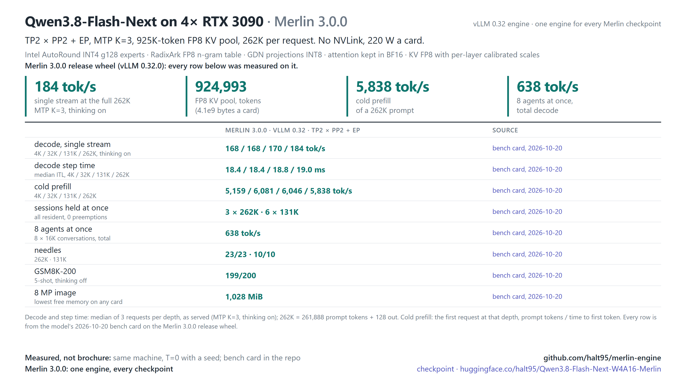

# Qwen3.8-Flash-Next on 4× RTX 3090

The launcher serves Froggeric's fixed Qwen3.8 template,
[`froggeric-qwen-v22.5.jinja`](../qwen38-27b/templates/froggeric-qwen-v22.5.jinja), the same template as the
27B recipes. Unlike the checkpoint's own `chat_template.jinja` (vendored in
[`models/flash-next/templates/`](../flash-next/templates/chat_template.jinja)), it accepts system messages after
the first turn, so coding agents' per-turn notes stay in place on `/v1/messages` and the prefix cache keeps
hitting. `CHAT_TEMPLATE=<path>` serves another template; `CHAT_TEMPLATE=` (empty) serves the checkpoint's own.

**Serve Qwen3.8-Flash-Next at its full 262K context on four RTX 3090s, with vision, tool calls and cached agent
follow-ups, behind one OpenAI-compatible endpoint.**

[](docs/reference.md#hardware)
[](docs/reference.md#the-kv-budget)
[](docs/reference.md#the-kv-budget)
[](docs/reference.md#stack)
[](docs/reference.md#stack)
[](https://huggingface.co/halt95/Qwen3.8-Flash-Next-W4A16-Merlin)

This directory is the Flash-Next recipe of the Merlin engine, **built on vLLM 0.32.0**: the launcher, KV-scale
sidecar, calibration tooling, Proxmox LXC recipe and docs for
[halt95/Qwen3.8-Flash-Next-W4A16-Merlin](https://huggingface.co/halt95/Qwen3.8-Flash-Next-W4A16-Merlin).
The engine source is at the repository root; checkpoints stay on Hugging Face. Recipe version:
[3.0.0](VERSION).

## Why use it

Maintainer measurements on 4× RTX 3090, vLLM 0.32, 2026-10-15.
The concurrency and cache-hit runs used a pre-release vLLM 0.32 build; later release-candidate and merged-source identity checks matched its
T=0 tokens and logprobs without rerunning throughput:

| Measurement | Result |
|---|---|
| Concurrent decode, six concurrent 126,976-token sessions | 574.5 tok/s aggregate; 10.78 ms/tok per agent; cold prefill 5,423 tok/s; 0 preemption |
| Cache hit, MTP off, 32K and 131K repeats | minimum hit ratio 0.998; 32K TTFT 5.78 → 0.315 s (cold → cached) |
| KV pool | 924,993 tokens |
| 8 MP image cap | stage-0 minimum free memory 902 MiB |

See the [0.32 measurement summary](benchmarks/2026-10-15/BENCH-CARD.md) for the evidence boundary.


The cache-hit measurement has MTP off; it does not establish that result for the launcher's default MTP K=3.
The concurrent decode workload is six **127K** sessions; six-131K residency was measured separately on 2026-10-20 (below).

## Merlin 3.0.0 bench card (2026-10-20)

Maintainer measurements on 4× RTX 3090 (220 W, PCIe Gen4 with P2P) with the Merlin 3.0.0 release wheel, one fresh `merlin serve` boot per configuration, 2026-10-20, with the BF16 draft head that 3.0.0 ships; method and every cell in the [bench card](benchmarks/2026-10-20/BENCH-CARD.md). Decode is one stream with thinking on (tok/s after the first streamed token); prefill is one cold request.

| Measurement | Flash-Next |
|---|---|
| Decode, 4K / 131K / 262K prompt | 168 / 170 / 184 tok/s |
| Cold prefill, 10K / 100K prompt | 5,660 / 6,051 tok/s |
| Sessions held at once | 3 × 262K and 6 × 131K, every session resident (re-sent prompts ≥ 99.91 % cached), 0 preemptions |
| 8 MP image, one and two requests at once | correct; lowest free memory on any card 1,028 MiB (one request) and 1,026 MiB (two at once) |
| KV pool | 924,993 tokens |
| Agents at once (8 × 16K conversations), total | 638 tok/s (BF16 draft head) |
| GSM8K-200 (5-shot, thinking off) | 199/200 |

## What's new in Merlin 3.0.0

- **Engine:** built on vLLM 0.32.0, with the engine source and model recipes in this checkout.
- **Vision:** 8 MP per image (`IMG_CAP_PX=8388608`) at the shipped KV pin
  (`--kv-cache-memory-bytes 4100000000`), with 902 MiB measured stage-0 headroom.
  The cap is a served default, not an enforced limit: a request that raises it
  (`mm_processor_kwargs`) goes past that headroom and can run the engine out of memory.
  The 1x M-RoPE cache is automatic on this engine. Up to 42 images are allowed by the launcher;
  the cap measurement does not establish every combination of image count and concurrent load.
- **FGPC off:** Flash-Next omits `--enable-mamba-shared-prefix-checkpoint`.
  Prefix caching remains enabled; FGPC is a separate feature.
- **Launch shape:** TP2 × PP2 with expert parallel, native context limit 262,144 tokens,
  MTP K=3 by default, FP8 KV, and a measured 924,993-token pool.

## What you need

The measured hardware is four headless RTX 3090s with working PCIe peer-to-peer. Other hardware and no-P2P
performance have not been re-measured here on 0.32. Other cards that `tools/merlin/preflight.py` maps to a
profile are **untested / community-validated**: RTX A5000, 3090 Ti and A10 (24 GB class, 3090 rows), A10G and L4 at
22.5 GiB (AWS g5/g6, GCP g2: pin lowered to the reported VRAM, a quad holds one 262K session), RTX A6000 / A40 (48 GB)
and the sm_80/sm_89 rows. 12 GB and 20 GB cards (RTX 3080 Ti, 3080 12 GB, RTX A4500) are refused. See the [hardware matrix](../../docs/merlin/hardware-matrix.md). Use the current repository-wide
[install status](../../release/README.md) for the toolchain and build route.

The imported provisioning guidance allocated 96 GB host RAM and at least 1 GB `/dev/shm`.
These allocations are retained as **v3.0.0 (0.30) figure** guidance; host-memory floor and boot peak
have not been re-qualified by this docs change. The checkpoint is approximately 115 GiB;
allow additional disk space for the environment, build products and caches. Total disk usage is unmeasured.
The checkpoint includes a host-resident n-gram embedding table, so host RAM matters as well as VRAM.

## Quick start

**The shared 0.32 installer is integrated.** The dependency lock is complete: 222 exact pins with artifact SHA-256 hashes, resolved with uv; a dry-run `--require-hashes` install resolves.
Follow [release/README.md](../../release/README.md); the engine is built from this checkout. The old v3.0.0 bundle and compiled-ops commands are historical and are not the Merlin 3.0.0 install route.

After a verified 0.32 build and environment are available, run from the repository root:

```bash
venv/bin/hf download halt95/Qwen3.8-Flash-Next-W4A16-Merlin --local-dir ~/models/Flash-Next-Merlin
TREE="$PWD" VENV="$PWD/venv" CACHE_ROOT="$PWD/.vllm-cache" \
  models/flash-next/serve.sh ~/models/Flash-Next-Merlin
```

The launcher requires the verified build-product marker from the installer. Wait for
`Application startup complete` and check `GPU KV cache size: 924,993 tokens`.
No 0.32 boot-time estimate is claimed. The endpoint defaults to `127.0.0.1:8000`; set `VLLM_API_KEY`
if exposing it with `HOST=0.0.0.0`.
See [health checks](docs/reference.md#check-its-working) and [troubleshooting](docs/reference.md#troubleshooting).

### Container

The shared [container recipe](../../container/README.md) builds this checkout through the 0.32
installer. Complete the dependency lock first; the image still needs hardware qualification.

### Proxmox LXC

The imported [LXC recipe](docs/reference.md#proxmox-lxc) describes the reference host's deployment.
Its provisioning/build integration has not been re-qualified on the imported 0.32 tree.

## Talk to it

Any OpenAI-compatible client works. With curl:

```bash
curl http://127.0.0.1:8000/v1/chat/completions -H 'Content-Type: application/json' \
  -d '{"model": "flash-next", "messages": [{"role": "user", "content": "Hello!"}]}'
```

Or from Python with the `openai` package (set `OPENAI_API_KEY` to your `VLLM_API_KEY`, or to any value if you set none):

```python
from openai import OpenAI
client = OpenAI(base_url="http://127.0.0.1:8000/v1")
reply = client.chat.completions.create(model="flash-next", messages=[{"role": "user", "content": "Hello!"}])
print(reply.choices[0].message.content)
```

- Thinking is on by default. A short `max_tokens` can end inside the reasoning with empty `content`; send
  `"chat_template_kwargs": {"enable_thinking": false}` to turn it off for a request.
- Tools use the standard `tools` field; images go in `image_url` content parts, up to 42 per request.
- If a reply comes back empty with `finish_reason: "stop"` and zero tokens, retry once.

## What's new in v3.0.0

v3.0.0 (gated 2026-10-10, never published) used vLLM 0.30. Its decode ladder, GSM8K, needle, follow-up reuse, idle-power,
warmup, boot-time and optional YaRN-entry results are historical: **v3.0.0 (0.30) figure**, not re-measured
on 0.32. The [v3.0.0 notes](CHANGELOG.md#v300) and
[historical bench card](benchmarks/2026-10-09/BENCH-CARD.md) retain those results and their original comparators.

## Documentation

- [CHANGELOG.md](CHANGELOG.md): Merlin 3.0.0 and historical recipe release notes.
- [docs/reference.md](docs/reference.md): launcher controls, capacity, deployment status and known behaviours.
- [2026-10-20 bench card](benchmarks/2026-10-20/BENCH-CARD.md): the measured Merlin 3.0.0 claims; [2026-10-15 0.32 summary](benchmarks/2026-10-15/BENCH-CARD.md): rc-build concurrency, cache-hit and identity runs.
- [v3.0.0 bench card](benchmarks/2026-10-09/BENCH-CARD.md): **v3.0.0 (0.30) figure** throughout.
- [docs/topology-selector.md](docs/topology-selector.md): opt-in topology selection.
- [docs/history.md](docs/history.md): earlier releases with their original measurement scope.

## Known limitations

- A custom KV pool must remain larger than the per-request context limit plus scheduling overhead.
- Cache-hit figures above were measured with MTP off. Multi-turn reuse percentages, full-pool follow-up
  losses and single-stream performance from 0.30 are not current 0.32 claims.
- Fresh-compile determinism, idle power, quality, startup time, larger image caps and the optional YaRN entry
  have not been re-measured for this docs update.
- The measured hardware is one reference 4× RTX 3090 host.

See [known behaviours](docs/reference.md#known-behaviours-of-the-qwen38-flash-next-architecture-in-vllm)
for historical observations and mitigations.

## Credits

Qwen ([Qwen3.8-Flash-Next](https://huggingface.co/Qwen/Qwen3.8-Flash-Next)), Intel
([AutoRound INT4 experts](https://huggingface.co/Intel/Qwen3.8-Flash-Next-W4A16-AutoRound)), RadixArk
([FP8 PLE table](https://huggingface.co/RadixArk/Qwen3.8-Flash-Next-NVFP4)), a community
idle-power report and contribution, brandon-nuttall (local-argmax mixin), mgabor3141
(club-3090 [discussion](https://github.com/noonghunna/club-3090/discussions/1572) report), DominikBucko
([MTP INT4 packing recipe](https://github.com/DominikBucko/qwen38-flash-next-2x3090)), the
[`peakcrosser7` Flash-Next branch](https://github.com/peakcrosser7/vllm/commits/release/qwen38next_offload) behind vLLM
[model-support](https://github.com/vllm-project/vllm/pull/53896) and [PLE-offload](https://github.com/vllm-project/vllm/pull/53899) contributions, and aikitoria's open-kernel-module patch (P2P on consumer Ampere). Upstream vLLM fixes in this
tree are credited by PR number in the commit messages and by author in `NOTICE` and in
[the full credit list](docs/reference.md#credit), which also names independent work on the same hardware class.

## License

Code in this repository (launchers, calibration tooling, harness): Apache-2.0 (the repository's `LICENSE`); the vLLM
fork is Apache-2.0 with the modified files listed in the repository's `NOTICE`. Model weights, including the quantised
derivatives credited above, carry the Qwen Community License 1.0 ([`licenses/LICENSE.qwen-community-1.0`](licenses/LICENSE.qwen-community-1.0)); they are not
part of this repository.
