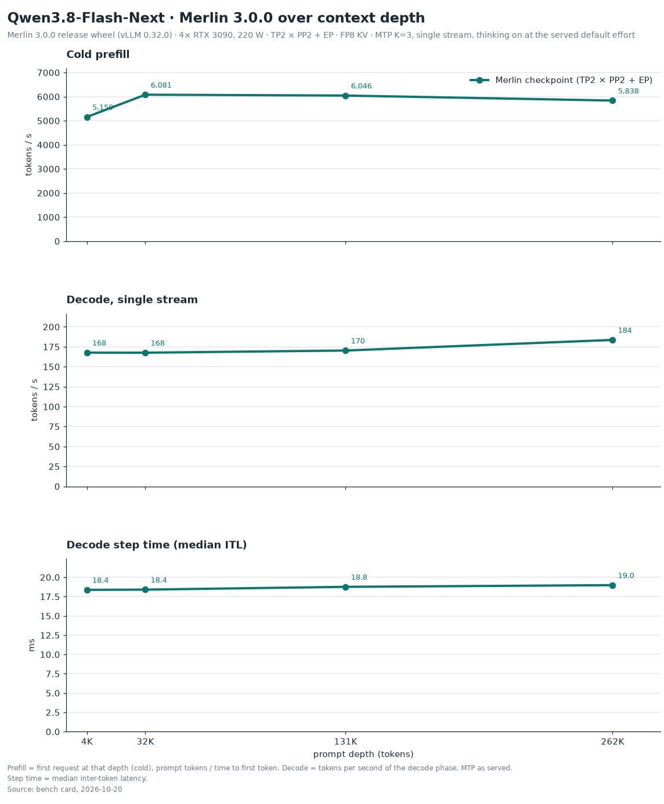

# Flash-Next 0.32 measurement summary — 2026-10-15

Merlin 3.0.0 (recipe 3.0.0), Merlin engine **built on vLLM 0.32.0**.

These measurements were recorded on 4× RTX 3090 on 2026-10-15 and supplied by the maintainer.
The design and cache-hit runs used a pre-release vLLM 0.32 engine build, 2026-10-15, at a 220 W power cap.
Later release-candidate and merged-source checks matched that build's T=0 tokens and logprobs on all four tested
configurations (28 documents plus four controls per configuration). Those checks establish output identity for that
sample; they do not rerun throughput. No new GPU run was performed for this docs change.
Raw benchmark streams, boot logs and a full release-gate card are not included here.

| Workload / measurement | Result |
|---|---|
| Six-session workload: Flash-Next 6×126,976 prompt tokens, 512 new tokens each | 574.5 tok/s aggregate |
| Six-session workload: latency per agent | 10.78 ms/tok |
| Six-session workload: cold prefill | 5,423 tok/s |
| Six-session workload: preemption | 0 |
| Cache hit with MTP off, 32K and 131K repeats | minimum hit ratio 0.998 |
| Cache hit with MTP off, 32K TTFT, cold → cached | 5.78 → 0.315 s |
| KV pool | 924,993 tokens |
| 8 MP image cap: stage-0 minimum free | 902 MiB |

The launcher ships an 8 MP per-image cap (`IMG_CAP_PX=8388608`) at the full
`--kv-cache-memory-bytes 4100000000` pin. FGPC is **off** for Flash-Next
(`--enable-mamba-shared-prefix-checkpoint` is omitted); prefix caching remains on.
The launcher defaults to MTP K=3. The cache-hit row explicitly uses MTP off and must not be presented
as a result for that default MTP configuration.

The six-session design workload is **6×126,976 prompt tokens** (approximately 6×127K). It does not re-measure the old 6×131K or 3×262K residency
claims. A token pool is aggregate capacity, not a guarantee for arbitrary concurrent requests:
hybrid state and scheduling also consume capacity.
The image-cap headroom measurement does not qualify every image-count and concurrency combination or larger caps.

The [v3.0.0 card](../2026-10-09/BENCH-CARD.md) is historical: **v3.0.0 (0.30) figure** throughout.
Its single-stream ladder, quality, needle, multi-turn reuse, idle power, startup times and optional
YaRN results have not been re-measured on 0.32 in the evidence supplied for this refresh.
The install, container and LXC routes still require their own integration and qualification;
see [release status](../../../../release/README.md).

Back to the [recipe README](../../README.md) and [reference](../../docs/reference.md).
