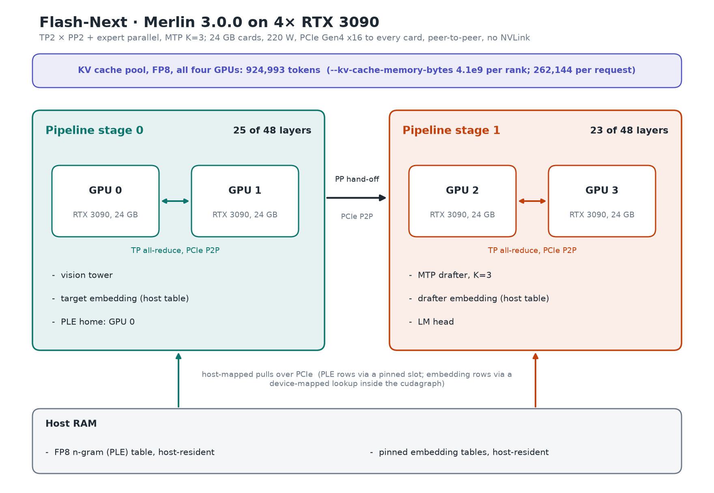

# Reference

The detail behind the [README](../README.md) for Merlin 3.0.0, Merlin engine **built on vLLM 0.32.0**.
The current measured claims are in [Benchmarks](#benchmarks). Historical measurements are explicitly marked
**v3.0.0 (0.30) figure**; their original release labels are retained, and they are not re-measured 0.32 results.

- [Overview](#overview)
- [Build and serve](#build-and-serve)
- [Container](#container) and [Proxmox LXC](#proxmox-lxc)
- [Check it's working](#check-its-working), [Troubleshooting](#troubleshooting)
- [Multi-GPU hosts and topology (opt-in)](#multi-gpu-hosts-and-topology-opt-in), [Running notes](#running-notes)
- [How it works](#how-it-works): [Hardware](#hardware), [The KV budget](#the-kv-budget),
  [Host-resident embeddings](#host-resident-embeddings-inside-the-cudagraph), [Stack](#stack),
  [Checkpoint](#checkpoint), [Serving an agent](#serving-an-agent)
- [Benchmarks](#benchmarks), [Known behaviours](#known-behaviours-of-the-qwen38-flash-next-architecture-in-vllm)
- [What ships next](#what-ships-next), [Credit](#credit)

## Overview

Qwen3.8-Flash-Next is served at its native 262,144-token context limit on four RTX 3090s:
TP2 × PP2 with expert parallel, MTP K=3 by default, and a measured **924,993-token FP8 KV pool**.
The host-mapped PLE table and host-resident token embeddings leave VRAM for model state and the KV cache.
The Merlin 3.0.0 engine is built on vLLM 0.32.0; its source lives at the repository root.

## Build and serve

**The shared 0.32 build and install routes are integrated.**
Use [release/README.md](../../../release/README.md). The dependency lock is complete
with 222 exact pins and artifact SHA-256 hashes; its uv dry-run hash-checked install resolves.
`release/install-env.sh` installs this checkout editable, with the compiled engine from
the release wheel or built from source. Historical bundles and binary assets do not
qualify this engine.

| Path | Purpose |
|---|---|
| `release/` | Shared installer, environment pins and release tooling; see its current status above |
| `models/flash-next/serve.sh` | Canonical 0.32 launcher; requires a verified build-product marker |
| `models/flash-next/make-e1-config.py` | Adds the checkpoint's PLE dtype key if missing |
| `models/flash-next/scales/qsa_kv_scales_262k.json` | Shipped FP8 KV-scale sidecar |
| `models/flash-next/lxc/` | Imported Proxmox deployment recipe; build integration unqualified on 0.32 |

After the installer has produced a verified build and environment, run from the repository root:

```bash
TREE="$PWD" VENV="$PWD/venv" CACHE_ROOT="$PWD/.vllm-cache" \
  models/flash-next/serve.sh /path/to/Qwen3.8-Flash-Next-W4A16-Merlin
```

The launcher defaults to the engine checkout, `venv/` and `.vllm-cache/` at the repository root.
It verifies build-product hashes before starting. A shadowing `vllm/` checkout in an unrelated working
directory can override the intended import; use the launcher's working-directory checks.

Keep the default `HOST=127.0.0.1` behind a proxy, or set `VLLM_API_KEY` when using `HOST=0.0.0.0`.
Extra arguments after the checkpoint go to `vllm serve`.

**Requirements and reproduction boundary.** The old Python, CUDA, driver, RAM, disk, startup and no-P2P
qualification numbers are **v3.0.0 (0.30) figure** guidance, not 0.32 install qualification.
Use the shared install documentation and `release/requirements-0.32.lock` for the current toolchain and pins. In particular, the old
compiled-ops reuse claim is not carried forward. The supplied current measurements use the reference
4×3090 host with working P2P; no no-P2P throughput result was supplied for 0.32.

## Container

The shared [container recipe](../../../container/README.md) builds this checkout through
the 0.32 installer. The route and complete 222-pin SHA-256 dependency lock are
integrated; a fresh install (2026-10-21) and a from-source build (2026-10-22) passed on the reference host; the container image is not yet qualified.

## Proxmox LXC

The imported recipe under `models/flash-next/lxc/` describes a privileged Debian LXC with the four cards
passed through. `lxc/pve-create.sh` creates the container; `lxc/provision.sh` installs userspace and the service;
`lxc/flash-next.service` starts serving, and `lxc/nvidia-prestart.sh` recreates the host device nodes at boot.
The device nodes must exist on the Proxmox host before the container starts; NVIDIA userspace in the
container must match the host module.

This provisioning route uses the shared 0.32 installer and verifies reused environments;
it has not been re-qualified on hardware with the final release tree.
The old allocation and timing measurements are **v3.0.0 (0.30) figure** guidance.
For current installation status, see [Build and serve](#build-and-serve).

## Check it's working

Wait for `Application startup complete` and verify `GPU KV cache size: 924,993 tokens` with the shipped pin.
Use a real generation to check health; `/v1/models` alone can answer even when the engine has died.

```bash
curl -s localhost:8000/v1/chat/completions -H 'Content-Type: application/json' \
  -d '{"model":"flash-next","messages":[{"role":"user","content":"ok"}],"max_tokens":16,"chat_template_kwargs":{"enable_thinking":false}}'
```

Add `Authorization: Bearer <key>` if `VLLM_API_KEY` is set.
First requests can compile kernels. The old readiness and warmup timings have not been re-measured on 0.32.

## Troubleshooting

- CUDA out-of-memory or a boot free-memory refusal: check for other GPU processes or a display server.
  A smaller `--kv-cache-memory-bytes` value can free memory, but changes capacity and needs qualification.
- A host OOM-killer event can indicate insufficient RAM for the host-resident tables.
  The legacy resident-floor estimate is not a new 0.32 measurement; see [Hardware](#hardware).
- `Bus error` at boot can indicate undersized `/dev/shm`.
- For import failures, check whether a stray `vllm/` directory shadows the intended engine checkout.
- `Unsupported .version` from PTX: compare the first-request compiler toolkit with the driver.
- A profile-guard refusal: check compilation mode, breakable graphs and other overrides against `serve.sh`.
- A missing `/dev/nvidia-uvm` at LXC start: recreate device nodes on the host and check the pre-start hook.
- `/v1/models` answers but generations fail: read the log from the first named guard, PLE or worker-exit cause.
- Empty content with `finish_reason: "length"`: thinking may have consumed the output budget.
  Raise `max_tokens` or send `"chat_template_kwargs":{"enable_thinking":false}`.
- Empty content with `finish_reason: "stop"` and zero tokens: retry once; see the historical observation below.

## Multi-GPU hosts and topology (opt-in)

By default `serve.sh` uses the settings the release was qualified with: GPUs 0-3 in PCI bus order, vLLM's P2P
check skipped, `NCCL_P2P_LEVEL=SYS`, `NCCL_PROTO=Simple`, FlashInfer's PCIe IPC all-reduce for decode
(`VLLM_ALLREDUCE_USE_FLASHINFER_PCIE_IPC=1`) and vLLM's custom all-reduce off. On a host that does not look like the reference one, set
`AUTO_TOPO=1`: serve then runs `models/flash-next/topo_select.py`, which reads the GPU topology from NVML and `/sys` and sets the
GPU order and the P2P and NCCL variables from it, falling back to the fixed settings on any doubt.

- **NVLink pairs**: the selector reorders the four GPUs so that each NVLink-bridged pair is a tensor-parallel pair,
  even when the bridged cards are not next to each other in bus order. This rule is derived from the topology NVML
  reports and covered by unit tests on a synthetic bridged topology; it has not been run on NVLink-bridged hardware.
- **More than four GPUs**: pick four by UUID (`nvidia-smi -L`), ideally on one NUMA node,
  `CUDA_VISIBLE_DEVICES=GPU-aaaa...,GPU-bbbb...,GPU-cccc...,GPU-dddd...` (format placeholders; substitute actual UUIDs).
  UUIDs do not depend on enumeration order.
  This works with the selector off too; with `AUTO_TOPO=1` it also checks the order and the P2P settings.


[docs/topology-selector.md](topology-selector.md) has the decision rules, `AUTO_TOPO=strict` and the other controls.

## Running notes

Use a release-specific environment and the installer-selected toolchain.
The launcher clears inherited fork knobs and exports its profile explicitly.
`GUARD` takes precedence over an inherited `VLLM_E2_GUARD_MODE`, then defaults to `warn`;
the current launcher accepts `raise|warn` and refuses `off`.
`VLLM_E2_GUARD_INTERVAL` must be finite and positive. The reader parks after the engine drains.

The PLE offload process deliberately refuses a CUDA context. Its blocked-CUDA-initialization messages are
expected. A named bounds-guard or transport failure is a reason to inspect the first error in the log.
The old allocator-warning counts, minimum free-memory observations and step-cost estimates are not
current measurements; retained historical detail is in the [release notes](../CHANGELOG.md).

## How it works

TP2 pairs form two pipeline stages. `VLLM_PP_LAYER_PARTITION=25,23` assigns layers to those stages.
Stage 0 owns the vision tower and target embedding; stage 1 owns the MTP drafter and vocabulary head.
The PLE table stays in host RAM, with rows pulled over PCIe, and token embeddings are host-resident.



The diagram shows the launcher's partition and the 924,993-token pool of the 2026-10-15 card; the retired v2.5 diagram's
host-memory sizes were 0.30 figures and are not carried over. See [The KV budget](#the-kv-budget) for the measured pool.

### Hardware

The supplied measurements use the reference 4× RTX 3090 host with PCIe peer-to-peer.
Legacy provisioning used 96 GB host RAM and at least 1 GB `/dev/shm`.
The checkpoint is approximately 115 GiB; allow additional disk space for the environment, build products and caches.
Those allocations, the approximately 69 GiB resident floor and the old 220 W power-cap qualification are
**v3.0.0 (0.30) figure** guidance; a 0.32 host-memory floor, boot peak and power measurement were not supplied.
No new hardware qualification is implied for no-P2P or NVLink configurations.

### The KV budget

The measured pool on 0.32 is **924,993 tokens**. The launcher pins
`--kv-cache-memory-bytes 4100000000` per rank with `--block-size 4096`.
The per-request context limit is 262,144 tokens. The pool is aggregate capacity, and hybrid state and
scheduling overhead also consume it.

The pre-release vLLM 0.32 run measured **six 126,976-token sessions**, with **0 preemption**, 574.5 tok/s aggregate,
10.78 ms/tok per agent and cold prefill 5,423 tok/s. Later release-candidate and merged-source checks matched its
T=0 tokens and logprobs; they did not rerun throughput. See the [measurement summary](../benchmarks/2026-10-15/BENCH-CARD.md).
The old three-262K and six-131K residency, no-MTP pool size, higher-pin ceilings and full-pool pressure
results are **v3.0.0 (0.30) figure** history in the [CHANGELOG](../CHANGELOG.md);
they have not been re-measured on 0.32 in the supplied evidence.

The current **8 MP per-image cap** (`IMG_CAP_PX=8388608`) at the shipped pin measured
**902 MiB stage-0 minimum free memory**. The engine uses the 1x M-RoPE cache automatically.
That headroom result does not qualify every image-count and concurrency combination.
Larger caps and a reduced-pin configuration have no new qualification here.

### Host-resident embeddings inside the cudagraph

`VLLM_HOST_EMBED_TABLE=1` keeps token embeddings in pinned host memory. Device-mapped lookups can replay
inside the draft cudagraph, unlike a CPU gather. The flag affects the compiled graph.
Old per-rank allocation sizes, VRAM savings and decode-neutrality comparisons are
**v3.0.0 (0.30) figure** history, not re-measured performance claims.
The implementation history is in [history.md](history.md).

### Stack

| Piece | Merlin 3.0.0 |
|---|---|
| Engine | Merlin, built on vLLM 0.32.0; source at the repository root |
| Environment and compiled ops | Shared 0.32 installer and engine wheel integrated; `release/requirements-0.32.lock` is complete with 222 exact pins and SHA-256 hashes; a fresh install (2026-10-21) and a from-source build (2026-10-22) passed on the reference host |
| Release dependency facts | humming-kernels 0.1.17; instanttensor ≥ 0.2.2 floor |
| Parallel shape | TP2 × PP2 + EP; layer partition 25,23 |
| Speculation | MTP K=3, probabilistic; full-vocabulary draft head, precision `DRAFT_HEAD=bf16\|int8\|int4` (default `bf16`); reduced draft vocabulary off and unavailable in this release (`REDUCED_DRAFT_VOCAB=1` needs `DRAFT_VOCAB=<path>` to the pinned table, which does not ship) |
| Context and scheduling | 262,144 tokens per request; up to 8 sequences; 1,024-token prefill chunk |
| KV | 4.1e9 bytes per rank, FP8 e4m3, shipped scale sidecar; block size 4,096 |
| Prefix caching | On, align mode, match unit 64; **FGPC off** (omit `--enable-mamba-shared-prefix-checkpoint`) |
| Vision | Up to 42 images per request; 8 MP per image; no video |
| Compilation | FULL_AND_PIECEWISE, captures through 32; breakable graphs off; V2 runner and RecoverSSM |
| Guard | `warn` by default; `raise` accepted; `off` refused by the launcher |
| Warm start | `WARM=1` by default; `WARM=0` opts out; no new 0.32 warmup-time claim |

These are launcher/configuration facts, distinct from measured performance.
[Earlier stacks](history.md#v201-stack) retain their original release scope.

### Checkpoint

The checkpoint remains [halt95/Qwen3.8-Flash-Next-W4A16-Merlin](https://huggingface.co/halt95/Qwen3.8-Flash-Next-W4A16-Merlin).
It needs `ple_embedding_dtype: float8_e4m3fn` inside `text_config` in `config.json`.
For an older download, `models/flash-next/make-e1-config.py` adds the key without changing weights.
The shipped sidecar is `scales/qsa_kv_scales_262k.json`. A Flash-Next-family checkpoint that ships its own scales as
`qsa_kv_scales.json` beside its weights is served with them (the launcher prints a note); `SCALES=<path>` overrides
both. Serve such a variant with `merlin serve flash-next <checkpoint-dir>`. No reduced draft-vocabulary table ships with this release, so the
`REDUCED_DRAFT_VOCAB=1` setting is unavailable: the launcher accepts only a `DRAFT_VOCAB=<path>` table whose sha256 is
pinned as `draft_vocab_sha256` in `tools/merlin/profiles/flash-next.json`, which is not distributed.
Checkpoint checksum lists are in `models/flash-next/checkpoint.sha256`.

### Serving an agent

| Need | Current configuration or measured result |
|---|---|
| Several long sessions | Concurrent decode: six 127K sessions, 0 preemption |
| Re-sent context | Prefix caching on, FGPC off; MTP-off 32K cache hit 0.998 and TTFT 5.78 → 0.315 s |
| Tools and thinking | Qwen3 coder tool parser, Qwen3 reasoning parser; thinking on at medium effort |
| Vision | 8 MP cap; 902 MiB measured stage-0 minimum free |
| Health | Check an actual generation and read the first named failure in the log |

The cache-hit row uses MTP off, unlike the launcher's default. It does not re-establish the old
multi-conversation follow-up reuse percentages under MTP.

## Benchmarks

The [2026-10-15 0.32 summary](../benchmarks/2026-10-15/BENCH-CARD.md) records the maintainer-supplied
Concurrent decode, cache-hit, image-cap and pool results. Raw streams, boot logs and a full release-gate card
are not included. No new GPU measurement was performed for this docs refresh.

The [2026-10-09 v3.0.0 card](../benchmarks/2026-10-09/BENCH-CARD.md) is historical:
**v3.0.0 (0.30) figure** throughout, including its v2.5.1 comparator and optional YaRN entry.
Single-stream throughput, GSM8K, needle, teacher-divergence, idle power, boot timing, multi-turn reuse and
fault campaigns from that era are not current 0.32 qualification.
Older cards remain linked from the [CHANGELOG](../CHANGELOG.md) and [history](history.md).

## Known behaviours of the Qwen3.8-Flash-Next architecture in vLLM

These observations and mitigations were carried from the older serving path.
Their incidence and qualification results are **v3.0.0 (0.30) figure** history;
no new rates, fault campaign or fresh-compile determinism claim are established here.

- Keep a custom KV pool larger than the per-request context limit plus scheduling overhead.
- An empty warm completion with `finish_reason: "stop"` and zero tokens was observed with cached prefixes.
  Retrying once helped in the historical runs; it is not a guarantee.
- Earlier hybrid-cache versions dropped finished sessions' prefixes while other sessions decoded.
  The later retention fixes and their original results are described in the
  [v2.5.1 notes](../CHANGELOG.md#what-changed-in-v251). The current MTP-off cache-hit measurement does not
  cover every full-pool, multi-turn workload.
- Bounds guards and PLE ownership checks report named failures. Older illegal-address incidents and
  containment tests do not establish absence of faults in this release.
- Greedy output can depend on GPU order, compile cache, layout and kernel build. Earlier within-cache and
  fresh-cache identity counts have not been re-measured for this refresh.
- Old thinking-off short-context comparisons and draft-acceptance differences remain historical results.

## What ships next

Merlin 3.0.0 ships the 0.32 launcher, 8 MP cap, FGPC off and the defaults listed in [Stack](#stack).
RecoverSSM metadata reuse and warm-start controls remain configured; the draft head scores the full vocabulary (`DRAFT_HEAD` sets its precision).
The old 34 MiB INT4 reduced-vocabulary draft-head cost and 22.5–33.0 W idle-power measurements are
**v3.0.0 (0.30) figure** results, not re-measured on 0.32.
Install integration, container qualification, larger image caps and the optional YaRN entry require their
own qualification. Local-argmax remains opt-in; no new performance result is claimed for it here.

## Credit

- Model: [Qwen/Qwen3.8-Flash-Next](https://huggingface.co/Qwen/Qwen3.8-Flash-Next)
- vLLM model support and PLE offload: the [`peakcrosser7` Flash-Next branch](https://github.com/peakcrosser7/vllm/commits/release/qwen38next_offload)
  behind the [model-support](https://github.com/vllm-project/vllm/pull/53896) and [PLE-offload](https://github.com/vllm-project/vllm/pull/53899) contributions
  (the latter closed without merging; upstream took a [UVA PLE offload](https://github.com/vllm-project/vllm/pull/54371) instead, which is in `v0.30.0`);
  in the v2.0.1 base and re-ported since v2.2.0: pipeline changes by saichowdary007;
  carried ahead of the base as five upstream-authored prefix-cache patches: work by ZeldaHuang, yewentao256,
  akshaver, tobymao and lucamotz. The [v2.0.1 structured-output fixes](history.md#what-changed-in-v201)
  and other carried changes retain their upstream authorship. The tree works around the
  [PP>1 refusal for PLE checkpoints](https://github.com/vllm-project/vllm/issues/54709).
  v2.2.0 builds on public vLLM `v0.30.0`, including eastwood-c's model-support work; its stage-ownership
  pattern is applied to this model. Re-ported changes also credit woosebastian, amittell, ArcheyChen,
  Prudctual, Karl0007, semerandre and wzhao18. v2.5.1 adds ten more upstream ports, including
  [RecoverSSM](https://github.com/vllm-project/vllm/pull/58863), the GDN state recovery for speculative
  decoding behind the larger pool. Original authorship remains in upstream history and `NOTICE`.
- Reports and contributions: a community idle-power report and contribution, brandon-nuttall (local-argmax mixin), mgabor3141 (club-3090 [discussion](https://github.com/noonghunna/club-3090/discussions/1572))
- Quantised experts: [Intel/Qwen3.8-Flash-Next-W4A16-AutoRound](https://huggingface.co/Intel/Qwen3.8-Flash-Next-W4A16-AutoRound);
  FP8 PLE table: [RadixArk/Qwen3.8-Flash-Next-NVFP4](https://huggingface.co/RadixArk/Qwen3.8-Flash-Next-NVFP4);
  MTP INT4 packing recipe adapted from [DominikBucko/qwen38-flash-next-2x3090](https://github.com/DominikBucko/qwen38-flash-next-2x3090);
  P2P on consumer Ampere: aikitoria's open-kernel-module patch
- Independent work on the same hardware class: Neiko2002,
  [noonghunna/club-3090](https://github.com/noonghunna/club-3090), [tfriedel/qwen3.6-rtx3090-lab](https://github.com/tfriedel/qwen3.6-rtx3090-lab)
