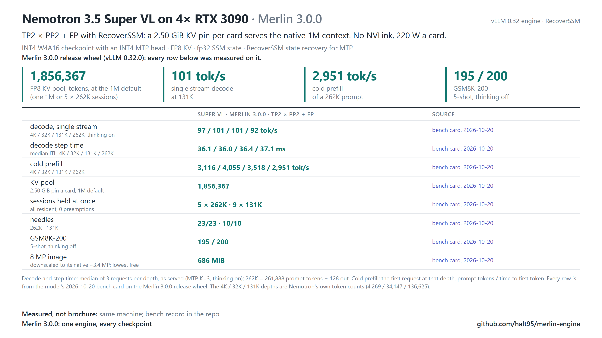

# Nemotron Super VL 120B-A12B on 4× RTX 3090

Super VL uses its checkpoint's Nemotron template, the `nemotron_v3`
reasoning parser and the `qwen3_coder` tool-call parser (the template writes tool calls in the Qwen3-Coder XML format;
NVIDIA's model card serves it the same way), rather than the Qwen templates used by the other recipes.
The Qwen recipes' Froggeric template does not apply to this launcher.

**Serve NVIDIA's Nemotron 3.5 Super VL (our W4A16 build with an INT4 MTP head) at its native 1M context on four RTX 3090s: TP2×PP2 with expert
parallelism, Mamba-2 RecoverSSM, MTP speculative decoding and prefix caching, behind one OpenAI-compatible endpoint.**

> **Status: tested on the reference host (registry profile `svl-quad-3090`).** The 3.0.0 release bench card passed this
> recipe on the reference host (2026-10-20; its agents, GSM8K and needle results are from a 2026-10-17 pre-release build). The KV pin below has not had a sustained-load test yet.



```bash
MODEL=~/models/nemotron-super-vl PORT=8100 bash models/nemotron-super-vl/serve.sh
# or, from the checkout: merlin serve nemotron-super-vl ~/models/nemotron-super-vl
```

Extra arguments go to `vllm serve` after the launcher's own flags (later flags win). Environment: `MODEL` (required), `GPUS`
(`0,1,2,3`), `PORT`, `HOST`, `SERVED` (`svl`), `VENV` (`<repo>/venv`), `TREE` (optional engine tree on `PYTHONPATH`), `CACHE_ROOT`,
`KV_BYTES`, `MNBT`, `SEQS`, `MAXLEN`, `BLOCK`, `PP_PARTITION`, `MAX_PIXELS`.

Token embeddings: with `VLLM_HOST_EMBED_TABLE` unset, the target and MTP `embed_tokens` tables sit in pinned host RAM (V2 model
runner; about 1 GiB of bf16 per full table, split across tensor-parallel ranks). `VLLM_HOST_EMBED_TABLE=0` keeps them on the GPU.

## Merlin 3.0.0 bench card (2026-10-20)

Maintainer measurements on 4× RTX 3090 (220 W, PCIe Gen4 with P2P) with the Merlin 3.0.0 release wheel, one fresh `merlin serve` boot per configuration, 2026-10-20, except the agents and GSM8K rows (a 2026-10-17 pre-release build); method and every cell in the [bench card](benchmarks/2026-10-20/BENCH-CARD.md). Decode is one stream with thinking on (tok/s after the first streamed token); prefill is one cold request.

| Measurement | Super VL |
|---|---|
| Decode, 4K / 131K / 262K prompt | 97 / 101 / 91 tok/s |
| Cold prefill, 10K / 100K prompt | 3,737 / 3,744 tok/s |
| Sessions held at once | 5 × 262K and 9 × 131K (the engine's sequence limit), every session resident (re-sent prompts ≥ 99.91 % cached), peak KV 95.0 %, 0 preemptions |
| 8 MP image | correct; the processor downscales it to its native ~3.4 MP cap; lowest free memory 686 MiB on any card |
| Agents at once (8 × 16K conversations), total | 429 tok/s (pre-release engine build of 2026-10-17) |
| GSM8K-200 (5-shot, thinking off) | 195/200 (pre-release engine build of 2026-10-17) |
| KV pool | 1,392,275 tokens (at a 262K context length; the shipped 1M default allocates 1,856,367) |

## The recipe

| Setting | Value | Why |
|---|---|---|
| Layout | TP2 × PP2 + expert parallel | four 24 GB cards, 120B weights at W4A16 |
| Layer partition | `VLLM_PP_LAYER_PARTITION=46,42` (`PP_PARTITION`) | pool unchanged (1,392,275 tokens at that run's 262K context length); stage 1 kept 870 MiB free under load, against 64 MiB at the even 44,44 split |
| State space | RecoverSSM: `--use-replayssm --mamba-backend triton`, Model Runner V2 | the engine selects RecoverSSM for NemotronH and requires the Triton Mamba backend |
| Speculation | MTP, 3 draft tokens, INT4 head | |
| Prefix cache | `--enable-prefix-caching --mamba-cache-mode align`, `--block-size 64 --prefix-match-unit 64` | block-size A/B on the reference host kept 64 |
| Chunk | `--max-num-batched-tokens 1024` | the Flash-Next default |
| KV | FP8, `--kv-cache-memory-bytes 2684354560` (2.50 GiB per card; no sustained-load test yet) | byte-pinned, never a utilisation fraction; at the 1M default the pool is 1,856,367 tokens: one 1M session (residency-proven) or 5 × 262K |
| Tools | `--enable-auto-tool-choice --tool-call-parser qwen3_coder` | the checkpoint card's vLLM recipe; the reasoning parser stays `nemotron_v3` |
| Images | `--limit-mm-per-prompt '{"image":1,"video":0}'`, `--mm-processor-cache-gb 0` | video off: the startup profiling item is sized to the whole context |

## Images

The release floor is 8 MP input. The model's own processor resizes every image to at most `vision_config.args.max_num_patches` =
13,312 patches (about 3.4 MP), so an 8 MP image is accepted and downscaled by the processor; there is no `--mm-processor-kwargs`
size cap to set for this model (unlike the 27B and Flash-Next launchers). `MAX_PIXELS` (unset by default, must be at least
8,388,608) only sets the admission limit `VLLM_MAX_IMAGE_PIXELS`, above which an image is rejected before decoding.

## GPU 0 headroom

The API-server process used to create a CUDA context (about 256 MiB) on GPU 0: the image preprocessor was a CPU `torch.compile`
function, and dynamo's trace step calls `torch.cuda.get_rng_state()` whenever CUDA is available, which initialises the primary
context on the first visible GPU during the multi-modal warmup. `_bicubic_resize_and_normalize` in
`vllm/transformers_utils/processors/nano_nemotron_vl.py` now runs eagerly (bit-identical output,
about 9 % slower on an 8 MP image), so stage 0's two cards have the same headroom. After boot, check that stage 0's two cards show the same free memory.

## License

Code in this directory (the launcher, tests and checksum lists): Apache-2.0 (the repository's [LICENSE](../../LICENSE)).
Model weights are not part of this repository. The checkpoint `halt95/Nemotron-3.5-Super-VL-120B-A12B-W4A16-Merlin` is a
quantised derivative of [`nvidia/NVIDIA-Nemotron-3.5-Super-VL-120B-A12B-BF16`](https://huggingface.co/nvidia/NVIDIA-Nemotron-3.5-Super-VL-120B-A12B-BF16)
and, like NVIDIA's original, is governed by the [OpenMDW License Agreement, version 1.1](https://openmdw.ai/license/1-1/)
([`licenses/LICENSE-OpenMDW-1.1`](licenses/LICENSE-OpenMDW-1.1)). Anyone who redistributes the checkpoint must keep the
agreement and the notices of origin with it; provenance and the checkpoint's notice are in
[`licenses/SuperVL-NOTICE`](licenses/SuperVL-NOTICE). "NVIDIA" and "Nemotron" are NVIDIA's names, used here only to describe
where the weights come from. This is a summary, not legal advice; the agreement governs.
