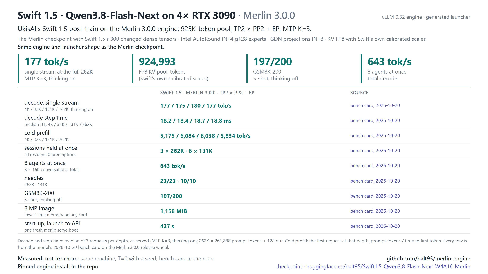

# Swift 1.5 · Merlin 3.0.0

The launcher serves Froggeric's fixed Qwen3.8 template,
[`froggeric-qwen-v22.5.jinja`](../qwen38-27b/templates/froggeric-qwen-v22.5.jinja), the same template as the
27B recipes. Unlike the checkpoint's own `chat_template.jinja` (vendored in
[`models/flash-next/templates/`](../flash-next/templates/chat_template.jinja)), it accepts system messages after
the first turn, so coding agents' per-turn notes stay in place on `/v1/messages` and the prefix cache keeps
hitting. `CHAT_TEMPLATE=<path>` serves another template; `CHAT_TEMPLATE=` (empty) serves the checkpoint's own.

Recipe version: [3.0.0](VERSION). The engine lives at the repository root and currently uses **vLLM 0.32.0** plus the Merlin changes. The weights stay on Hugging Face:

[halt95/Swift1.5-Qwen3.8-Flash-Next-W4A16-Merlin](https://huggingface.co/halt95/Swift1.5-Qwen3.8-Flash-Next-W4A16-Merlin).

This is a W4A16 build of [UkisAI's Swift 1.5](https://huggingface.co/ukisai/Swift1.5-Qwen3.8-Flash-Next) post-train: the Merlin checkpoint with Swift's 300 changed dense tensors transplanted. It is an independent derivative made by halt95, not made, reviewed or endorsed by UkisAI or Qwen.

## Qualification status

The canonical [serve.sh](serve.sh) is generated from the checkpoint profile in `tools/merlin/profiles/flash-next.json` by `tools/merlin/preflight.py`; it starts this checkout directly. It passed its qualification run on 2026-10-16: boot 443 s, GSM8K-20 19/20, ITL 4K / 32K 18.78 / 18.84 ms, 27/27 T=0 outputs matched the Flash-Next quad's Swift 1.5 outputs (report-only because argv differs); the 2026-10-20 Merlin 3.0.0 release bench card then passed it: GSM8K-200 197/200, pool 924,993; needles 23/23 at 262K and 10/10 at 131K (needle panel from the 2026-10-17 pre-release build). It is tested on the reference host.

| Evidence | Merlin 3.0.0 status |
|---|---|
| Swift vision at 8 MP (8,388,608 pixels per image) | Measured on 2026-10-15 on 4× RTX 3090 / 0.32: **stage-0 minimum free memory 902 MiB** (different served configuration). Generated launcher, 2026-10-16 8 MP burst after 8K prefill: **544 MiB**, 20 MiB above the 524 MiB floor |
| Generated 0.32 launcher on the assembled release tree | the launcher qualification passed (2026-10-16); the 2026-10-20 release bench card passed: tested on the reference host |
| KV pool and session residency | 924,993 tokens was measured on the generated launcher (2026-10-16); 3 × 262K and 6 × 131K sessions held at once on the 2026-10-20 bench card |
| Decode, prefill, follow-up latency and quality | 2026-10-20 bench card (BF16 draft head, below): decode 177 / 180 / 177 tok/s at 4K / 131K / 262K, cold prefill 5,676 / 6,055 tok/s at 10K / 100K; agents (8 × 16K) 643 tok/s, GSM8K-200 197/200. Historical, the 2026-10-17 pre-release bench run (INT8 draft head): agents aggregate 256 / 409 / 657 tok/s at n=2 / 4 / 8, GSM8K 198/200. The launcher qualification measured GSM8K-20 19/20 and ITL 18.78 / 18.84 ms at 4K / 32K; other earlier results are historical |



[Swift1.5-Huihui](../swift1.5-huihui/README.md) inherits Swift's heavy results. Its generated launcher independently passed the 2026-10-16 8 MP gate with 902 MiB minimum free.

## Merlin 3.0.0 bench card (2026-10-20)

Maintainer measurements on 4× RTX 3090 (220 W, PCIe Gen4 with P2P) with the Merlin 3.0.0 release wheel, one fresh `merlin serve` boot per configuration, 2026-10-20, with the BF16 draft head that 3.0.0 ships; method and every cell in the [bench card](benchmarks/2026-10-20/BENCH-CARD.md). Decode is one stream with thinking on (tok/s after the first streamed token); prefill is one cold request.

| Measurement | Swift1.5 |
|---|---|
| Decode, 4K / 131K / 262K prompt | 177 / 180 / 177 tok/s |
| Cold prefill, 10K / 100K prompt | 5,676 / 6,055 tok/s |
| Sessions held at once | 3 × 262K and 6 × 131K, every session resident (re-sent prompts ≥ 99.91 % cached), 0 preemptions |
| 8 MP image, one and two requests at once | correct; lowest free memory 1,158 MiB on any card |
| KV pool | 924,993 tokens |
| Agents at once (8 × 16K conversations), total | 643 tok/s (BF16 draft head) |
| GSM8K-200 (5-shot, thinking off) | 197/200 |

## Quick start

This Merlin 3.0.0 checkout includes the generated 0.32 launcher. Build and install the engine from this checkout using the repository-wide [release instructions](../../release/README.md); installation and container qualification are separate release gates.

The shared 0.32 installer is integrated. The dependency lock is complete: 222 exact pins with artifact SHA-256 hashes, resolved with uv; a dry-run `--require-hashes` install resolves. From the repository root, with the Hugging Face CLI available:

```bash
venv/bin/hf download halt95/Swift1.5-Qwen3.8-Flash-Next-W4A16-Merlin \
  --revision 3c9a1159eac1282463b06313de7dd9262edf8b58 --local-dir ./ckpt-swift
(cd ckpt-swift && sha256sum -c ../models/swift1.5/checkpoint.sha256)

# The generated launcher inherits CUDA_HOME; select the locked venv toolkit.
export CUDA_HOME="$(venv/bin/python -c 'import sysconfig; print(sysconfig.get_paths()["purelib"])')/nvidia/cu13"
export PATH="$CUDA_HOME/bin:$PATH"
TREE="$PWD" VENV="$PWD/venv" CACHE_ROOT="$PWD/.vllm-cache" \
  bash models/swift1.5/serve.sh "$PWD/ckpt-swift"
```

Set `VENV` to the environment in which this checkout was installed. Reference host: NVIDIA driver 610.43.02 (reports CUDA 13.3). The release lock selects a matched CUDA 13.0 toolkit (nvcc, crt, nvvm, nvJitLink 13.0.88, cccl 13.0.85, runtime 13.0.96, the pair torch 2.13.0 cu130 ships with); the release wheel is served on it by every recipe (2026-10-20). Other CUDA 13.x drivers (R580 or later) are expected to work through CUDA minor-version compatibility, but are untested. See the [driver requirements](../../release/install-0.32.md). The checksum list leaves out the HF card's `README.md`, so card edits do not affect verification.

## Launcher defaults

| Setting | Generated Swift profile |
|---|---|
| Profile | `fn-swift1.5-quad-3090` (select explicitly; automatic hardware selection chooses Flash-Next) |
| Hardware/layout | 4× RTX 3090 24 GB with P2P; TP2 × PP2 + EP, layer partition 25,23 |
| Context/admission | 262,144 tokens per request, 8 sequences, 1,024 batched tokens |
| KV | FP8 E4M3, `--kv-cache-memory-bytes 4100000000` per card; [Swift-specific scales](scales/kv_scales-swift-e4m3.json) |
| Images | Up to 42; default cap 8,388,608 pixels per image, overridden with `IMG_CAP_PX` |
| MTP | K=3, full-vocabulary head (`DRAFT_HEAD=bf16\|int8\|int4`, default bf16); `REDUCED_DRAFT_VOCAB=0` only (`=1` is unavailable: no reduced draft table ships or is qualified) |
| Caching | Prefix caching and RecoverSSM, block size 4,096, prefix-match unit 64; FGPC **off** |
| Thinking/tools | Thinking on at `medium` (`xhigh` per request); Qwen3 reasoning and Qwen3 coder tool parsers |
| Served names | `flash-next-v2`, `flash-next`, `flash-mtp`, `flash-next-mtp` |
| Endpoint | `127.0.0.1:8000` by default; `HOST`, `PORT`, `MODEL_NAME` override it |

Additional vLLM arguments follow the checkpoint path. See the [reference](docs/reference.md#build-and-serve) for environment overrides. The tested Swift profile is the P2P-on 4 x RTX 3090 row. Other hardware has untested Swift rows (a no-P2P quad, sm_89, sm_86 48 GB and sm_80 layouts): `merlin serve swift1.5` picks one that fits the host, or name it with `--profile`; they are listed in the [hardware matrix](../../docs/merlin/hardware-matrix.md).

## Talk to it

```bash
curl http://127.0.0.1:8000/v1/chat/completions -H 'Content-Type: application/json' \
  -d '{"model":"flash-next","messages":[{"role":"user","content":"Hello!"}],"chat_template_kwargs":{"enable_thinking":false}}'
```

Requests may choose `reasoning_effort` or disable thinking through `chat_template_kwargs`. At `xhigh`, a short output cap can end inside reasoning before answer content appears.

## Documentation

- [Reference](docs/reference.md): generated launcher contract, hardware, memory evidence and checks.
- [Changelog](CHANGELOG.md): Merlin 3.0.0 recipe changes and earlier releases.
- [2026-10-06 bench card](benchmarks/2026-10-06/BENCH-CARD.md) and [loop check](docs/loop-check.md): historical vLLM 0.30 measurements, not Merlin 3.0.0 qualification.
- [Container](../../container/README.md): repository-wide route; Swift container build and serving remain unqualified.

## Known limitations

The generated launcher passed its qualification run and the 3.0.0 bench card. The 544 MiB result (20 MiB above the floor) records the generated launcher's measured 8 MP stage-0 margin; it is not a guarantee for larger images, other layouts or other hardware. Legacy speed, quality and cache-reuse numbers remain in their dated records.

## Credits

Qwen ([Qwen3.8-Flash-Next](https://huggingface.co/Qwen/Qwen3.8-Flash-Next)), UkisAI
([Swift 1.5](https://huggingface.co/ukisai/Swift1.5-Qwen3.8-Flash-Next)), Intel
([AutoRound INT4 experts](https://huggingface.co/Intel/Qwen3.8-Flash-Next-W4A16-AutoRound)), RadixArk
([FP8 PLE table](https://huggingface.co/RadixArk/Qwen3.8-Flash-Next-NVFP4)), DominikBucko
([MTP INT4 packing recipe](https://github.com/DominikBucko/qwen38-flash-next-2x3090)), and the Merlin engine on
[vLLM](https://github.com/vllm-project/vllm). Checkpoint provenance is in the
[reference](docs/reference.md#checkpoint).

## License

Code in this directory (the launcher and the documentation): Apache-2.0 (the repository's `LICENSE`); the
engine is the repository root and carries its own licence and `NOTICE`. The KV-scale sidecar
(`scales/kv_scales-swift-e4m3.json`) and the checkpoint you serve are subject to the Swift Open License v1.0
(`licenses/LICENSE-SWIFT`) and the Qwen Community License 1.0 (`licenses/LICENSE-QWEN`). Two terms to know before commercial use:

- Swift Open License: Commercial Use by a Legal Entity with US$1,000,000 or more in gross revenue (most recent fiscal
  year, with its affiliates) is not licensed; a Qualified Non-Profit Organization's Non-Commercial or Research Purposes
  are exempt, and UkisAI offers a separate Swift Enterprise License (§§1 and 5).
- Qwen Community License: a product or service with more than 100,000,000 monthly active users or more than
  US$20,000,000 monthly revenue must display the model name prominently; a Model as a Service or AI Work Assistant
  business needs a separate Qwen licence before commercial use, with a narrow internal-use exception (§§1–2).

The full summary is in [docs/reference.md](docs/reference.md#licence-detail). It is not legal advice; the licence texts
govern. "UkisAI" and "Swift" are UkisAI's names, used here only to describe where the weights come from.
